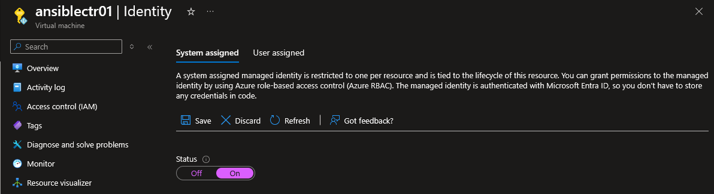

# Azure IAC Bicep for Ansible lab


## Table of content

- [Install az cli / bicep on ansiblectr01](#install-az-cli--bicep)

## Install az cli / bicep on ansiblectr01


```bash
azureuser@ansiblectr01:~$ sudo nano install_az_cli_and_bicep.sh
```

content

```bash
#!/usr/bin/env bash
# Version: 1.0.0
# Description: Installs Azure CLI and Bicep on Ubuntu 26.04 without colored output.

set -euo pipefail

sudo apt-get update
sudo apt-get install -y curl ca-certificates gnupg lsb-release apt-transport-https

if ! curl -sL https://aka.ms/InstallAzureCLIDeb | sudo bash; then
    echo "Apt repository unavailable for this Ubuntu release; falling back to pipx installation."
    sudo apt-get install -y pipx python3-venv
    pipx ensurepath
    pipx install azure-cli
    export PATH="$HOME/.local/bin:$PATH"
fi

# Disable ANSI colors in Azure CLI output
az config set core.no_color=true

# Install Bicep CLI for compiling and decompiling templates
az bicep install

az version
az bicep version
```

run it

```bash
azureuser@ansiblectr01:~$ bash ./install_az_cli_and_bicep.sh

```
log

```console
No VM guests are running outdated hypervisor (qemu) binaries on this host.
Installing Bicep CLI v0.49.2...
WARNING: The configuration value of bicep.use_binary_from_path has been set to 'false'.
Successfully installed Bicep CLI to "/home/azureuser/.azure/bin/bicep".
{
  "azure-cli": "2.93.0",
  "azure-cli-core": "2.93.0",
  "azure-cli-telemetry": "1.1.0",
  "extensions": {}
}
Bicep CLI version 0.49.2 (b34271ac51)
```
## Managed identity

Authenticate and Query Existing Infrastructure

You can enable the identity from the Azure Portal (recommended for the initial bootstrap) or via a one-time interactive CLI login.



Log in from your Ubuntu 26.04 terminal (use --use-device-code over SSH, or --identity if you assign a Managed Identity to this Ubuntu VM):

```bash

```

## Get information


## Tear down nodes


## Create nodes

