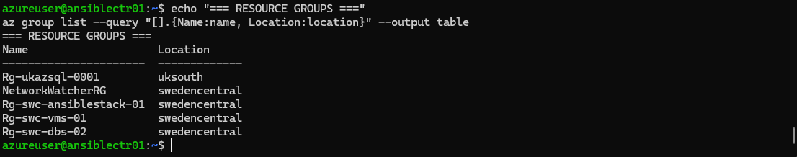

# Azure IAC Bicep for Ansible lab


## Table of content

- [Install az cli / bicep on ansiblectr01](#install-az-cli--bicep)

## Install az cli / bicep on ansiblectr01


```bash
azureuser@ansiblectr01:~$ sudo nano install_az_cli_and_bicep.sh
```

content

```bash
#!/usr/bin/env bash
# Version: 1.0.0
# Description: Installs Azure CLI and Bicep on Ubuntu 26.04 without colored output.

set -euo pipefail

sudo apt-get update
sudo apt-get install -y curl ca-certificates gnupg lsb-release apt-transport-https

if ! curl -sL https://aka.ms/InstallAzureCLIDeb | sudo bash; then
    echo "Apt repository unavailable for this Ubuntu release; falling back to pipx installation."
    sudo apt-get install -y pipx python3-venv
    pipx ensurepath
    pipx install azure-cli
    export PATH="$HOME/.local/bin:$PATH"
fi

# Disable ANSI colors in Azure CLI output
az config set core.no_color=true

# Install Bicep CLI for compiling and decompiling templates
az bicep install

az version
az bicep version
```

run it

```bash
azureuser@ansiblectr01:~$ bash ./install_az_cli_and_bicep.sh

```
log

```console
No VM guests are running outdated hypervisor (qemu) binaries on this host.
Installing Bicep CLI v0.49.2...
WARNING: The configuration value of bicep.use_binary_from_path has been set to 'false'.
Successfully installed Bicep CLI to "/home/azureuser/.azure/bin/bicep".
{
  "azure-cli": "2.93.0",
  "azure-cli-core": "2.93.0",
  "azure-cli-telemetry": "1.1.0",
  "extensions": {}
}
Bicep CLI version 0.49.2 (b34271ac51)
```
## Managed identity

Authenticate and Query Existing Infrastructure

1. Enable System-Assigned Managed Identity on the VM

You can enable the identity from the Azure Portal (recommended for the initial bootstrap) or via a one-time interactive CLI login.


Verification: An Object (principal) ID GUID appears on the Identity blade once saved.

2. Assign RBAC Permissions

Grant the Managed Identity permissions so it can query your existing VNet/VMs and create or delete dedicated per-VM Resource Groups.

* Via Azure Portal (on the same Identity blade):
* Click Azure role assignments under the System assigned tab.
* Click + Add role assignment.
* Set Scope to Subscription and Role to Contributor, then click Save.

Verification: Contributor appears under the VM's role assignments list at the Subscription scope.

3. Authenticate and Verify on Ubuntu 26.04


```bash
# Clear any previous interactive session and log in using the VM Managed Identity
az logout 2>/dev/null || true
az login --identity --output json

echo "=== RESOURCE GROUPS ==="
az group list --query "[].{Name:name, Location:location}" --output table
```




Managed Identity authentication and Subscription read access are working. Your lab infrastructure is located in swedencentral across Rg-swc-ansiblestack-01, Rg-swc-vms-01, and Rg-swc-dbs-02.

## Get information


```bash
SUB_ID=$(az account show --query "id" --output tsv)

echo "=== SUBSCRIPTION ==="
echo "SUB_ID loaded (length: ${#SUB_ID})"

az login --identity --output json

echo "=== RESOURCE GROUPS ==="
az group list --query "[].{Name:name, Location:location}" --output table

```

Pull the files from git

```bash
azureuser@ansiblectr01:~$ cd ansible-io-ot-lab/
git pull origin main
```

Now run

```bash
bash azure_iac_bicep_create_or_tear_down/get_info.sh

bash azure_iac_bicep_create_or_tear_down/get_info_vms_disk_and_nsg.sh

# Checking mysql01_DataDisk_0 Exact Size
az disk show --resource-group "Rg-swc-dbs-02" --name "mysql01_DataDisk_0" --output json | grep -iE "diskSize|sku"
```

## Run in check mode what-if

```bash
azureuser@ansiblectr01:~/ansible-io-ot-lab$ 

bash azure_iac_bicep_create_or_tear_down/scripts/check_what_if.sh

```

All three what-if checks returned Status: Succeeded with the exact expected resource topology:

* Rg-swc-mysql-01 (mysql01): 10.68.68.6 (Static) on iDMZ, Standard_B2s, mysql01_OsDisk_1, 8 GiB mysql01_DataDisk_0 (LUN 0), mysql01-nic, and mysql01-nsg (TCP/22).

* Rg-swc-zabbix-01 (zabbix01): 10.68.68.5 (Static) on iDMZ, Standard_B2s, zabbix01_OsDisk_1, zabbix01-nic, and zabbix01-nsg (TCP/22).

* Rg-swc-zabbix-02 (zabbix02): 10.68.20.4 (Static) on OT, Standard_B2s, zabbix02_OsDisk_1, zabbix02-nic, and zabbix02-nsg (TCP/22).


TODO Next Steps to Deploy


Remove the old Resource Groups to free the static IPs (omit --no-wait so the command blocks until Azure releases 10.68.68.6, 10.68.68.5, and 10.68.20.4 from vnet_swc_01):

```bash
# This is a one time only, to remove the manual environment.

az group delete --name "Rg-swc-dbs-02" --yes
az group delete --name "Rg-swc-vms-01" --yes

# or do it in the portal

```
## Create nodes 27.08.2026

Deploy all three VMs into their dedicated Resource Groups:

```bash
azureuser@ansiblectr01:~/ansible-io-ot-lab$ 

bash azure_iac_bicep_create_or_tear_down/scripts/deploy.sh
```
Log

```console
Enter admin password for VMs:
Creating Resource Group: Rg-swc-mysql-01
Deploying mysql01.bicepparam into Rg-swc-mysql-01...
Name    State      Timestamp                         Mode         ResourceGroup
------  ---------  --------------------------------  -----------  ---------------
vm      Succeeded  2026-11-27T22:10:03.330457+00:00  Incremental  Rg-swc-mysql-01
Creating Resource Group: Rg-swc-zabbix-01
Deploying zabbix01.bicepparam into Rg-swc-zabbix-01...
Name    State      Timestamp                         Mode         ResourceGroup
------  ---------  --------------------------------  -----------  ----------------
vm      Succeeded  2026-11-27T22:10:40.342067+00:00  Incremental  Rg-swc-zabbix-01
Creating Resource Group: Rg-swc-zabbix-02
Deploying zabbix02.bicepparam into Rg-swc-zabbix-02...
Name    State      Timestamp                         Mode         ResourceGroup
------  ---------  --------------------------------  -----------  ----------------
vm      Succeeded  2026-11-27T22:11:46.882922+00:00  Incremental  Rg-swc-zabbix-02
All VM deployments completed.
```

## Add autoshutdown to vms

Add autoshutdown with mail at 01:00 AM.

## Add ssh keys to vms


```bash
# we hav ealready generated the rsa key on ansiblectr01

# remove old know hosts
ssh-keygen -f '/home/azureuser/.ssh/known_hosts' -R '10.68.68.6'

ssh-keygen -f '/home/azureuser/.ssh/known_hosts' -R '10.68.68.6'

ssh-keygen -f '/home/azureuser/.ssh/known_hosts' -R '10.68.20.4'

# add current key to host

ssh-copy-id -i ~/.ssh/id_rsa.pub azureuser@10.68.68.6

ssh-copy-id -i ~/.ssh/id_rsa.pub azureuser@10.68.68.5

ssh-copy-id -i ~/.ssh/id_rsa.pub azureuser@10.68.20.4

# login one time normal with password
ssh azureuser@10.68.68.6
# password

ssh azureuser@10.68.68.5
# password

ssh azureuser@10.68.20.4
# password

# Now try logging into the machine, with:
# ssh login with key no pass
ssh azureuser@10.68.68.6

ssh azureuser@10.68.68.5

ssh azureuser@10.68.20.4

```

Now we can just run Ansible as normal.


## Tear down nodes after 27.08.2026

```bash
azureuser@ansiblectr01:~/ansible-io-ot-lab$ 

bash azure_iac_bicep_create_or_tear_down/scripts/teardown.sh

``` 

Log

```console

```

