# Ansible stack in Azure Proof of Concept (PoC) 

Use Azure together with Ansible to build a POC for IT/OT Lab environment.

In this POC we use Azure so we can share a live demo from Azure simulating IT/OT environment.


<details>
<summary>BG</summary>

Things that we need to investgate and test is marked with bg and a number, bg information can be found in the bg folder.

In Bg we do the job manually, understand the case and document, then apply automation with playbooks.

</details>

The same lab was set up with:

KVM (for Kernel-based Virtual Machine) is a full virtualization solution for Linux on x86 hardware containing virtualization extensions (Intel VT or AMD-V). It consists of a loadable kernel module, kvm.ko, that provides the core virtualization infrastructure and a processor specific module, kvm-intel.ko or kvm-amd.ko.

Using KVM, one can run multiple virtual machines running unmodified Linux or Windows images. Each virtual machine has private virtualized hardware: a network card, disk, graphics adapter, etc.

KVM is open source software. The kernel component of KVM is included in mainline Linux, as of 2.6.20. The userspace component of KVM is included in mainline QEMU, as of 1.3. 

* https://github.com/spawnmarvel/kvm-lab/tree/main

## Table of content
- [Ansible stack in Azure Proof of Concept (PoC)](#ansible-stack-in-azure-proof-of-concept-poc)
  - [Table of content](#table-of-content)
- [Ansible](#ansible)
    - [Introduction to Ansible](#introduction-to-ansible)
    - [Ansible on Azure Microsoft](#ansible-on-azure-microsoft)
    - [Ansible explained in 60 seconds youtube and other videos](#ansible-explained-in-60-seconds-youtube-and-other-videos)
    - [Ansible.Builtin](#ansiblebuiltin)
    - [Ansible Collection Index](#ansible-collection-index)
    - [Example ansible.windows.win\_updates module – Download and install Windows update](#example-ansiblewindowswin_updates-module--download-and-install-windows-update)
    - [Semaphore UI for Ansible](#semaphore-ui-for-ansible)
    - [Ansible and Red Hat models 🎩](#ansible-and-red-hat-models-)
    - [What You Can Do for Free 🆓](#what-you-can-do-for-free-)
    - [Where You Hit a Wall (The Trade-offs) 💸](#where-you-hit-a-wall-the-trade-offs-)
    - [The Bottom Line](#the-bottom-line)
    - [Red Hat Ansible Automation Platform delivers on high ROI expectations](#red-hat-ansible-automation-platform-delivers-on-high-roi-expectations)
    - [Unified orchestration](#unified-orchestration)
    - [Official Ansible Documentation Portal](#official-ansible-documentation-portal)
    - [Ansible provides open-source automation that reduces complexity and runs everywhere.](#ansible-provides-open-source-automation-that-reduces-complexity-and-runs-everywhere)
    - [Introduction to Ansible Guide: Ansible Introduction \& Use Cases](#introduction-to-ansible-guide-ansible-introduction--use-cases)
    - [Red Hat Ansible Automation Platform Overview:](#red-hat-ansible-automation-platform-overview)
    - [This module is able to configure a FortiGate or FortiOS (FOS) device](#this-module-is-able-to-configure-a-fortigate-or-fortios-fos-device)
    - [Ansible Network Examples](#ansible-network-examples)
    - [Ansible can configure and manage network switches from a wide variety of hardware vendors using specialized](#ansible-can-configure-and-manage-network-switches-from-a-wide-variety-of-hardware-vendors-using-specialized)
    - [Ansible can configure, provision, and manage several major hypervisors and virtualization platforms](#ansible-can-configure-provision-and-manage-several-major-hypervisors-and-virtualization-platforms)
- [IT Automation in OT](#it-automation-in-ot)
  - [Introduction to scenario](#introduction-to-scenario)
  - [Team 1 and Team 2 scenario](#team-1-and-team-2-scenario)
  - [1. Topology for the future](#1-topology-for-the-future)
- [Start IT/OT Lab](#start-itot-lab)
  - [Firewal and practical information](#firewal-and-practical-information)
  - [Whitelisted repo for ansiblectr01](#whitelisted-repo-for-ansiblectr01)
  - [Firewall Rule Matrix (Purdue / ISA-95 Architecture)](#firewall-rule-matrix-purdue--isa-95-architecture)
  - [Vnet and subnet](#vnet-and-subnet)
  - [VM's Azure Retirement of default outbound access: scope and impact](#vms-azure-retirement-of-default-outbound-access-scope-and-impact)
  - [Virtual machines in Rg-swc-ansiblestack-01](#virtual-machines-in-rg-swc-ansiblestack-01)
  - [Virtual machines in Rg-swc-vms-01](#virtual-machines-in-rg-swc-vms-01)
- [Ansible configuration POC](#ansible-configuration-poc)
  - [Create ansiblectr01 Subnet 1 (iDMZ / Management)](#create-ansiblectr01-subnet-1-idmz--management)
  - [Install Ansible on ansiblectr01](#install-ansible-on-ansiblectr01)
    - [Create folder structure](#create-folder-structure)
  - [Create zabbix01 Subnet 1 (iDMZ / Management)](#create-zabbix01-subnet-1-idmz--management)
  - [Populate folder structure and verify ssh](#populate-folder-structure-and-verify-ssh)
    - [Enable passwordless, secure SSH authentication and log on ansiblectr01 in /opt/ansible](#enable-passwordless-secure-ssh-authentication-and-log-on-ansiblectr01-in-optansible)
  - [Playbook linux ping\_hosts.yml](#playbook-linux-ping_hostsyml)
  - [Set up apt-cacher-ng and Apache on ansiblectr01](#set-up-apt-cacher-ng-and-apache-on-ansiblectr01)
    - [Allowed remote repositories](#allowed-remote-repositories)
  - [Playbook linux configure\_apt\_proxy.yml](#playbook-linux-configure_apt_proxyyml)
    - [Veriy manual update on zabbix01](#veriy-manual-update-on-zabbix01)
  - [Playbook linux update\_apt.yml with callbacks\_enabled = profile\_tasks, timer](#playbook-linux-update_aptyml-with-callbacks_enabled--profile_tasks-timer)
  - [Current vms](#current-vms)
- [Semaphore UI POC](#semaphore-ui-poc)
  - [Install Semaphore UI on ansiblectr01 with SQLite](#install-semaphore-ui-on-ansiblectr01-with-sqlite)
    - [We could do it with Ansible playbook also/ this is manual install to get to know it](#we-could-do-it-with-ansible-playbook-also-this-is-manual-install-to-get-to-know-it)
    - [Accessing Semaphore UI](#accessing-semaphore-ui)
    - [SSL/TLS Certificates](#ssltls-certificates)
    - [Apache in front of Semaphore for secure HTTPS access](#apache-in-front-of-semaphore-for-secure-https-access)
  - [Setup Ansible ansiblectr01 with Semaphore](#setup-ansible-ansiblectr01-with-semaphore)
  - [Playbooks linux Semaphore run](#playbooks-linux-semaphore-run)
    - [linux ping\_hosts.yml](#linux-ping_hostsyml)
    - [linux update\_apt.yml](#linux-update_aptyml)
- [2. Topology at this stage](#2-topology-at-this-stage)
- [Set up the rest of the stack](#set-up-the-rest-of-the-stack)
  - [Create mysql01 and zabbix02](#create-mysql01-and-zabbix02)
  - [No outbound to internet](#no-outbound-to-internet)
  - [Structure inventory/hosts.ini and align all configurations](#structure-inventoryhostsini-and-align-all-configurations)
    - [Add ssh keys for new hosts](#add-ssh-keys-for-new-hosts)
    - [Playbook linux yml update hosts and verify current templates](#playbook-linux-yml-update-hosts-and-verify-current-templates)
  - [Run linux ping\_hosts.yml Semaphore](#run-linux-ping_hostsyml-semaphore)
    - [Playbook Linux verify\_firewall\_isolation.yml](#playbook-linux-verify_firewall_isolationyml)
    - [Playbook Linux configure\_apt\_proxy.yml](#playbook-linux-configure_apt_proxyyml-1)
    - [Playbook Linux update\_apt.yml patch all hosts with one click](#playbook-linux-update_aptyml-patch-all-hosts-with-one-click)
  - [Playbook Configure a Dedicated Template per Host/Group (Recommended) in Semaphore](#playbook-configure-a-dedicated-template-per-hostgroup-recommended-in-semaphore)
  - [Semaphore statistic](#semaphore-statistic)
- [Playbooks with Ansible (Now we can really start)](#playbooks-with-ansible-now-we-can-really-start)
- [3. Topology at this stage](#3-topology-at-this-stage)
  - [Update inventory/host.ini](#update-inventoryhostini)
  - [Playbook get\_linux\_version.yml](#playbook-get_linux_versionyml)
  - [Playbook linux mount\_datadrive\_check.yml](#playbook-linux-mount_datadrive_checkyml)
- [1. Manually attach a data disk to a Linux VM UUID](#1-manually-attach-a-data-disk-to-a-linux-vm-uuid)
- [1.1 Playbook linux mount\_datadrive\_for\_mysql.yml (risky Azure spesific)](#11-playbook-linux-mount_datadrive_for_mysqlyml-risky-azure-spesific)
  - [1.2 Jinja2 expression is extremely close to a generic template](#12-jinja2-expression-is-extremely-close-to-a-generic-template)
  - [1.3 Add prompt before executing Step 3 ansible.builtin.pause](#13-add-prompt-before-executing-step-3-ansiblebuiltinpause)
      - [We can add prompts to semaphore later, let's continue cli](#we-can-add-prompts-to-semaphore-later-lets-continue-cli)
    - [1.4  Idempotent data disk discovery, partitioning, ext4 formatting, UUID extraction, persistent fstab mounting at /mnt/datadrive1, and reboot verification.](#14--idempotent-data-disk-discovery-partitioning-ext4-formatting-uuid-extraction-persistent-fstab-mounting-at-mntdatadrive1-and-reboot-verification)
  - [1.5 Restart mysql01 and verify datadisk](#15-restart-mysql01-and-verify-datadisk)
  - [1.6 Run the mount\_datadrive\_for\_mysql\_azure.yml with boot step](#16-run-the-mount_datadrive_for_mysql_azureyml-with-boot-step)
    - [The output from blkid and findmnt confirms that your storage configuration is working exactly as designed to handle Azure's device letter shuffling.](#the-output-from-blkid-and-findmnt-confirms-that-your-storage-configuration-is-working-exactly-as-designed-to-handle-azures-device-letter-shuffling)
- [Set up github integration on ansiblectr01 for git pull origin main](#set-up-github-integration-on-ansiblectr01-for-git-pull-origin-main)
- [Update Semaphore to use ansible-io-ot-lab and not io\_io\_lab folder](#update-semaphore-to-use-ansible-io-ot-lab-and-not-io_io_lab-folder)
- [Pause and inspect all playbooks with comments](#pause-and-inspect-all-playbooks-with-comments)
- [Introduction to Enterprise Ansible Scalability](#introduction-to-enterprise-ansible-scalability)
  - [1. Ansible Roles (Modular Structure)](#1-ansible-roles-modular-structure)
  - [2. Jinja2 Templates (.j2)](#2-jinja2-templates-j2)
  - [3. Handlers (Event-Driven Service Restarts)](#3-handlers-event-driven-service-restarts)
  - [4. Ansible Vault (Secure Secret Management)](#4-ansible-vault-secure-secret-management)
  - [5. Custom Facts and Block/Rescue Error Handling](#5-custom-facts-and-blockrescue-error-handling)
- [Let's start Enterprise Ansible Scalability](#lets-start-enterprise-ansible-scalability)
  - [Playbook install\_mysql.yml with Roles --check or limit or hosts:groups](#playbook-install_mysqlyml-with-roles---check-or-limit-or-hostsgroups)
    - [1 Role Directory Structure](#1-role-directory-structure)
    - [playbooks/deploy\_mysql\_check.yml](#playbooksdeploy_mysql_checkyml)
    - [playbooks/deploy\_mysql.yml --limit mysql01](#playbooksdeploy_mysqlyml---limit-mysql01)
      - [Verify mysql as root and zabbix via ssh on localhost](#verify-mysql-as-root-and-zabbix-via-ssh-on-localhost)
    - [playbooks/login\_mysql\_check.yml --limit mysql01 with var zabbix\_password](#playbookslogin_mysql_checkyml---limit-mysql01-with-var-zabbix_password)
  - [playbooks/deploy\_mysql.yml --limit mysql01 Ansible Vault](#playbooksdeploy_mysqlyml---limit-mysql01-ansible-vault)
    - [1. Encrypt Your Variables File](#1-encrypt-your-variables-file)
      - [Option A: Interactive Prompt (Best for Manual Runs)](#option-a-interactive-prompt-best-for-manual-runs)
      - [Option B: Vault Password File (Best for Automation / CI/CD)](#option-b-vault-password-file-best-for-automation--cicd)
      - [Configure Semaphore with a Vault Password](#configure-semaphore-with-a-vault-password)
- [Reboot mysql01 and verify all playbooks before install zabbix](#reboot-mysql01-and-verify-all-playbooks-before-install-zabbix)
  - [deploy\_mysql.yml information on multiple deploy bg1](#deploy_mysqlyml-information-on-multiple-deploy-bg1)
- [Playbook deploy\_zabbix.yml --check or limit or hosts:groups](#playbook-deploy_zabbixyml---check-or-limit-or-hostsgroups)
- [Windows new project ansible-io-ot-lab-windows](#windows-new-project-ansible-io-ot-lab-windows)


# Ansible 


###  Introduction to Ansible


Ansible provides open-source automation that reduces complexity and runs everywhere. Using Ansible lets you automate virtually any task. Here are some common use cases for Ansible:

* Eliminate repetition and simplify workflows

* Manage and maintain system configuration

* Continuously deploy complex software

* Perform zero-downtime rolling updates

Ansible uses simple, human-readable scripts called playbooks to automate your tasks. You declare the desired state of a local or remote system in your playbook. Ansible ensures that the system remains in that state.

As automation technology, Ansible is designed around the following principles:

* Agent-less architecture

Low maintenance overhead by avoiding the installation of additional software across IT infrastructure.

* Simplicity

Automation playbooks use straightforward YAML syntax for code that reads like documentation. Ansible is also decentralized, using SSH with existing OS credentials to access remote machines.

* Scalability and flexibility

Easily and quickly scale the systems you automate through a modular design that supports a large range of operating systems, cloud platforms, and network devices.

* Idempotence and predictability

When the system is in the state your playbook describes, Ansible does not change anything, even if the playbook runs multiple times.

* https://docs.ansible.com/projects/ansible/latest/getting_started/introduction.html

### Ansible on Azure Microsoft

Red Hat Ansible integrates with Microsoft technologies to automate cloud infrastructure, Windows Server environments, and Active Directory (AD).

https://learn.microsoft.com/en-us/azure/developer/ansible/


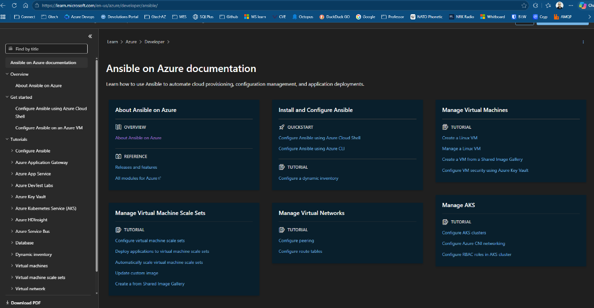


### Ansible explained in 60 seconds youtube and other videos

Ansible explained in 60 seconds

* https://www.youtube.com/shorts/qygKrliJbRg

Ansible and Terraform in 60 seconds youtube

* https://www.youtube.com/shorts/q2ZfgKPvp2E

You need to learn Ansible right now - 20 min

* https://www.youtube.com/watch?v=5hycyr-8EKs

---

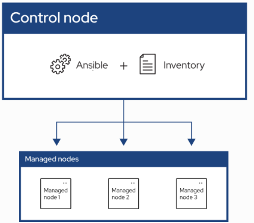


As shown in the preceding figure, most Ansible environments have three main components:

* Control node
  A system on which Ansible is installed. You run Ansible commands such as ansible or ansible-inventory on a control node.

* Inventory
  A list of managed nodes that are logically organized. You create an inventory on the control node to describe host deployments to Ansible.


```ini
# Version: 2.0.0
# Description: Multi-zone Ansible static inventory defining topological zones, functional roles, and connection parameters.

[control_node]
ansiblectr01 ansible_host=10.68.68.4 ansible_user=azureuser ansible_connection=local

[idmz_nodes]
zabbix01 ansible_host=10.68.68.5 ansible_user=azureuser
mysql01 ansible_host=10.68.68.6 ansible_user=azureuser

[ot_nodes]
zabbix02 ansible_host=10.68.20.4 ansible_user=azureuser
```

* Managed node
  A remote system, or host, that Ansible controls, all the host in the inventory.


Now you can make playbook and run it on all hosts.


Playbook

```yml
---
# Version: 1.0.1
# Author: aspen
# Description: Ping validation playbook with privilege escalation explicitly disabled

- name: Verify Connectivity Across Purdue Lab Nodes
  hosts: ot_nodes:idmz_nodes
  gather_facts: false
  become: false
  tasks:
    - name: Ping all inventory hosts
      ansible.builtin.ping:
```

Docs


* https://docs.ansible.com/projects/ansible/latest/getting_started/index.html


### Ansible.Builtin

* https://docs.ansible.com/projects/ansible/latest/collections/ansible/builtin/index.html

### Ansible Collection Index

* https://docs.ansible.com/projects/ansible/latest/collections/index.html

### Example ansible.windows.win_updates module – Download and install Windows update

ansible.windows.win_updates:

* https://docs.ansible.com/projects/ansible/latest/collections/ansible/windows/win_updates_module.html

### Semaphore UI for Ansible

Short video

* https://www.youtube.com/watch?v=LVKwud2Wno4


Docs Getting started with Ansible

* https://semaphoreui.com/

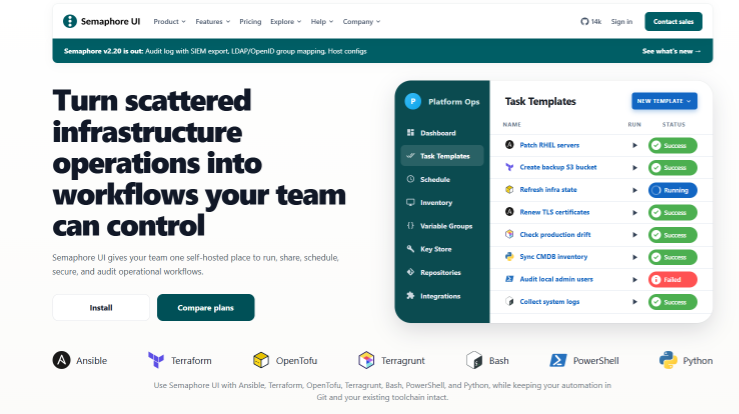


### Ansible and Red Hat models 🎩

Ansible is owned by Red Hat, a subsidiary of IBM.

Open-Source Core: The core Ansible project (including Ansible Core) is free and open-source software licensed under the GNU General Public License version 3 (GPL-3.0)

"The core Ansible project (including Ansible Core)"

* The engine: This refers to the foundational software that actually runs your automation tasks from the command line.

* The essentials: It includes the core engine, basic built-in tools, and the framework needed to automate servers, networks, and cloud setups without any paid add-ons.


You can go all the way to full-scale enterprise production with the open-source version of Ansible. There are no artificial limits on the number of servers, features, or automation tasks you can run for free.


### What You Can Do for Free 🆓

* Unlimited Scale: You can automate 5 servers or 50,000 servers without paying a dime.
* Full Automation Power: Every core capability—like configuring servers, deploying apps, managing cloud infrastructure (AWS, Azure, Google Cloud), and configuring network hardware—works out of the box.
* Access Community Modules: You get free access to thousands of pre-built automation scripts (called Collections) created by the community and major tech vendors on Ansible Galaxy.
* Add a Free Web UI: If you outgrow the command line, you can install AWX (the free, open-source version of Red Hat's visual dashboard) or Semaphore UI (a lightweight, popular open-source web interface for Ansible).
* Integrate with CI/CD: You can easily plug free Ansible into other free tools like GitLab CI, GitHub Actions, or Jenkins to schedule jobs, store passwords securely, and track who ran what.


### Where You Hit a Wall (The Trade-offs) 💸

While there are no technical walls, you will eventually face operational trade-offs as your team grows:

* Maintenance Burden: Running free tools like AWX requires a dedicated Kubernetes cluster and regular manual upgrades, which takes time and expertise to maintain.
* No Safety Net: If a critical production automation breaks at 2:00 AM, you have to fix it yourself using documentation and community forums rather than calling Red Hat support.
* Compliance & Auditing: Strict industries (like banking or healthcare) often require legally certified software and guaranteed vendor accountability, which only comes with a paid subscription.


### The Bottom Line

If you have a skilled technical team willing to manage your own setup, you never have to pay for Ansible. Companies usually only pay when they want to save engineering time on maintenance, pass compliance audits easily, or get 24/7 vendor support.


### Red Hat Ansible Automation Platform delivers on high ROI expectations

In a world where organizations are continually asked to do more with less, IT leaders are always looking for new technologies and strategies that can help their teams become more agile and efficient. 

Doing so frees up time and resources that can be better used to deliver the essential technologies needed to drive business success.

https://www.redhat.com/en/blog/red-hat-ansible-automation-platform-delivers-high-roi-expectations

---

### Unified orchestration

🚀 Domain Expertise: 

Each specialized team focuses on the technical areas they master best whether:

* Configuring network switches and firewalls
* Managing Linux server deployments and patching
* Orchestrating virtual machines

🌀 Unified Orchestration: 

Ansible acts as the central hub that bridges these distinct technical silos, allowing disparate infrastructure layers to be managed through a single automated workflow.

🚤 End-to-End Delivery: 

By combining their specialized knowledge and working in close harmony, the teams ensure that the entire technology stack functions reliably, securely, and efficiently as a cohesive end product.

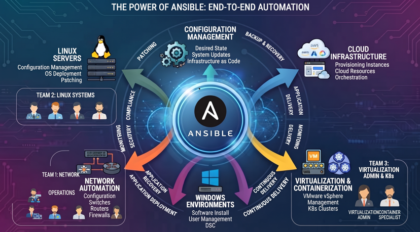


### Official Ansible Documentation Portal

The primary hub for getting started, understanding core concepts (inventories, playbooks, modules), and managing managed nodes.

https://docs.ansible.com/


### Ansible provides open-source automation that reduces complexity and runs everywhere.

https://docs.ansible.com/projects/ansible/latest/getting_started/introduction.html

### Introduction to Ansible Guide: Ansible Introduction & Use Cases

Covers the foundational design principles (agentless architecture, idempotency, and supported workflows).

https://docs.ansible.com/projects/ansible/latest/getting_started/introduction.html


### Red Hat Ansible Automation Platform Overview:


Details enterprise-grade execution, multi-vendor network automation, cloud provisioning, and orchestration features.

https://www.redhat.com/en/technologies/management/ansible

### This module is able to configure a FortiGate or FortiOS (FOS) device

This module is able to configure a FortiGate or FortiOS (FOS) device by allowing the user to set and modify system feature and interface category. Examples include all parameters and values need to be adjusted to datasources before usage. Tested with FOS v6.0.0

https://docs.ansible.com/projects/ansible/latest/collections/fortinet/fortios/fortios_system_interface_module.html


### Ansible Network Examples

This document describes some examples of using Ansible to manage your network infrastructure.

https://docs.ansible.com/projects/ansible/latest/network/user_guide/network_best_practices_2.5.html

### Ansible can configure and manage network switches from a wide variety of hardware vendors using specialized


Major Supported Switch Platforms

| Vendor / Platform Family | Operating System & Edition               | Ansible Collection / Module Namespace |
| :----------------------- | :--------------------------------------- | :------------------------------------ |
| **Cisco**                | Cisco IOS / IOS-XE                       | `cisco.ios`                           |
| **Cisco**                | Cisco NX-OS (Nexus)                      | `cisco.nxos`                          |
| **Cisco**                | Cisco IOS-XR                             | `cisco.iosxr`                         |
| **Cisco**                | Cisco Meraki                             | `cisco.meraki`                        |
| **Arista**               | Arista EOS                               | `arista.eos`                          |
| **Juniper**              | Juniper Junos OS                         | `junipernetworks.junos`               |
| **Dell**                 | Dell OS6, OS9, OS10 (PowerSwitch)        | `dell.os6`, `dell.os9`, `dell.os10`   |
| **Aruba / HP**           | Aruba, ProCurve, Comware                 | Community and vendor modules          |
| **Other Vendors**        | VyOS                                     | `vyos.vyos`                           |
| **Other Vendors**        | Nokia SR OS                              | `nokia.sros`                          |
| **Other Vendors**        | Extreme Networks, Huawei, MikroTik, etc. | EXOS, VOSS, CloudEngine, RouterOS     |


https://docs.ansible.com/projects/ansible/latest/collections/index.html


### Ansible can configure, provision, and manage several major hypervisors and virtualization platforms

Ansible can configure, provision, and manage several major hypervisors and virtualization platforms using official or community-supported Ansible collections.


Supported and Configurable Hypervisors

| Hypervisor / Cloud Platform                          | Ansible Collection                                                                         | Core Capabilities & Management Features                                                                                             |
| :--------------------------------------------------- | :----------------------------------------------------------------------------------------- | :---------------------------------------------------------------------------------------------------------------------------------- |
| **VMware (vSphere / ESXi / vCenter)**                | `community.vmware` (or certified `vmware.vmware` / `vmware.ansible_vcenter_plugin` suites) | Provision, clone, power on/off, reconfigure VMs, manage datastores, networks, and dynamic inventories                               |
| **Proxmox VE (Virtual Environment)**                 | `community.proxmox`                                                                        | Create, start, stop, delete, and configure KVM virtual machines and LXC containers                                                  |
| **Microsoft Hyper-V & SCVMM**                        | `microsoft.hyperv` and `microsoft.scvmm`                                                   | Provision VMs, manage virtual processors, memory, network adapters, and Windows-specific guest configurations via PowerShell Direct |
| **KVM / Libvirt (Linux Kernel-based VM)**            | `community.libvirt` (e.g., `community.libvirt.virt_install`)                               | Declare and provision virtual machines via libvirt and qemu                                                                         |
| **Amazon EC2 / Cloud Hypervisors (AWS, Azure, GCP)** | `amazon.aws`, `azure.azcollection`, `google.cloud`                                         | Manage cloud-native instances running on underlying hypervisor fleets                                                               |

You can browse and install these modules via the Ansible Community Documentation Index or Ansible Galaxy.

Ansible Community Documentation

https://docs.ansible.com/projects/ansible/latest/collections/index.html

Ansible Galaxy

https://galaxy.ansible.com/ui/

# IT Automation in OT

## Introduction to scenario

🎯 Objectives & Key Highlights

* Multi-Zone Network Segregation: Isolates management tasks in an internal DMZ (iDMZ / Zone 2.5) from operational technology targets (OT / Zone 2.0) using Azure Network Security Groups (NSGs).

* Controlled Caching & Software Delivery: Implements an internal caching proxy (apt-cacher-ng) on the control node (ansiblectr01) to safely handle system packages, updates, and repository mirroring without exposing target nodes directly to the public internet.

* Modern Web Orchestration: Deploys Ansible Semaphore UI fronted by an Apache HTTPS reverse proxy with TLS termination for secure, role-based pipeline and playbook execution.

* Infrastructure as Code (IaC): MySQL, Zabbix Zabbix proxy, update Linux servers , etc,  and cross-platform configuration playbooks entirely through version-controlled automation.

* Multi-Platform Support: Orchestrates management routines across both modern Linux distributions (Ubuntu Server) and Windows Server targets using native Ansible execution modules.

🔄 Operational Scenario

1. Day 1 (Infrastructure Provisioning): The core infrastructure team provisions clean Ubuntu and Windows Server virtual machines within Azure following standard deployment templates.

2. Day 2 (Control Plane & Security Baseline): The automation team establishes ansiblectr01 as the central control node, configures secure SSH key-based authentication, sets up internal package caching, and deploys Semaphore UI.

3. Day 3 and Beyond (Day-2 Operations & Lifecycle Management): Routine maintenance, configuration enforcement, database storage provisioning, and targeted security patching (such as specific Windows KB updates) are executed reliably through automated playbooks with a single click.

## Team 1 and Team 2 scenario

Datacenter Handover: The datacenter build team manually provisions clean Ubuntu 26.04 and Windows Server VMs via GUI..

Day-2 automation begins immediately after IP and credential handover.


## 1. Topology for the future

This is the final set up (ip may change but the concept is the same)

1. Team 1 can use Terraform / Ansible or do it manually for network, firewall, provision servers etc.
2. Team 2 will use Ansible for configuration management, install, montitoring, patching etc.

---

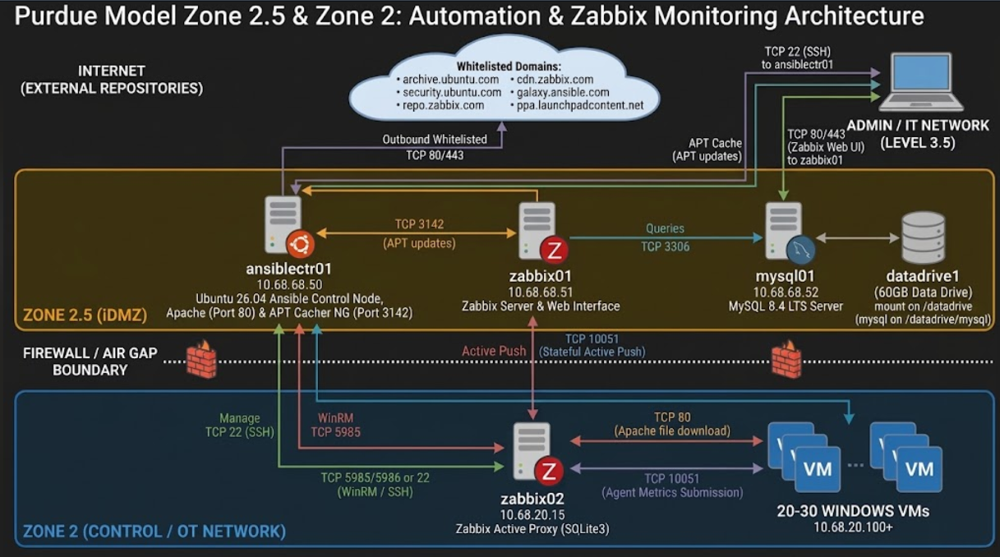


# Start IT/OT Lab

Now it gets a bit technical, so ready for the ride or just want to see the demo?


## Firewal and practical information

## Whitelisted repo for ansiblectr01

| Rule ID    | Source Host    | Source Zone     | Destination FQDN / Host                          | Destination Zone    | Protocol / Port | Purpose                                                            |
| :--------- | :------------- | :-------------- | :----------------------------------------------- | :------------------ | :-------------- | :----------------------------------------------------------------- |
| **FW-01a** | `ansiblectr01` | Zone 2.5 (iDMZ) | `archive.ubuntu.com`, `security.ubuntu.com`      | External / Internet | TCP 80, 443     | Ubuntu base OS packages, security patches, and system dependencies |
| **FW-01b** | `ansiblectr01` | Zone 2.5 (iDMZ) | `ppa.launchpadcontent.net`, `galaxy.ansible.com` | External / Internet | TCP 80, 443     | Ansible PPA repository and Ansible Galaxy collection access        |
| **FW-01c** | `ansiblectr01` | Zone 2.5 (iDMZ) | `repo.zabbix.com`                                | External / Internet | TCP 80, 443     | Zabbix official repository and package updates                     |

## Firewall Rule Matrix (Purdue / ISA-95 Architecture)

| Rule ID    | Source Host           | Source Zone         | Destination FQDN / Host                          | Destination Zone    | Protocol / Port      | Purpose                                             |
| :--------- | :-------------------- | :------------------ | :----------------------------------------------- | :------------------ | :------------------- | :-------------------------------------------------- |
| **FW-01a** | `ansiblectr01`        | Zone 2.5 (iDMZ)     | `archive.ubuntu.com`, `security.ubuntu.com`      | External / Internet | TCP 80, 443          | Ubuntu OS repository update traffic                 |
| **FW-01b** | `ansiblectr01`        | Zone 2.5 (iDMZ)     | `repo.zabbix.com`, `cdn.zabbix.com`              | External / Internet | TCP 80, 443          | Zabbix APT repository & Agent2 `.msi` downloads     |
| **FW-01c** | `ansiblectr01`        | Zone 2.5 (iDMZ)     | `ppa.launchpadcontent.net`, `galaxy.ansible.com` | External / Internet | TCP 80, 443          | Ansible PPA repository & Ansible Galaxy collections |
| **FW-02**  | `ansiblectr01`        | Zone 2.5 (iDMZ)     | `zabbix01`, `mysql01`                            | Zone 2.5 (iDMZ)     | TCP 22               | Ansible SSH configuration & management              |
| **FW-03**  | `ansiblectr01`        | Zone 2.5 (iDMZ)     | `zabbix02`                                       | Zone 2 (Control/OT) | TCP 22               | Ansible SSH configuration & management              |
| **FW-04**  | `ansiblectr01`        | Zone 2.5 (iDMZ)     | Windows VMs                                      | Zone 2 (Control/OT) | TCP 5985, 5986 or 22 | Ansible WinRM / SSH management                      |
| **FW-05**  | `zabbix01`, `mysql01` | Zone 2.5 (iDMZ)     | `ansiblectr01`                                   | Zone 2.5 (iDMZ)     | TCP 3142             | Internal APT package updates (`apt-cacher-ng`)      |
| **FW-06**  | `zabbix02`            | Zone 2 (Control/OT) | `ansiblectr01`                                   | Zone 2.5 (iDMZ)     | TCP 3142             | Internal APT package updates (`apt-cacher-ng`)      |
| **FW-07**  | Windows VMs           | Zone 2 (Control/OT) | `ansiblectr01`                                   | Zone 2.5 (iDMZ)     | TCP 80               | Apache HTTP download of `zabbix_agent2.msi`         |
| **FW-08**  | `zabbix01`            | Zone 2.5 (iDMZ)     | `mysql01`                                        | Zone 2.5 (iDMZ)     | TCP 3306             | MySQL database query traffic                        |
| **FW-09**  | `zabbix02`            | Zone 2 (Control/OT) | `zabbix01`                                       | Zone 2.5 (iDMZ)     | TCP 10051            | Active Proxy metric data push                       |
| **FW-10**  | Windows VMs           | Zone 2 (Control/OT) | `zabbix02`                                       | Zone 2 (Control/OT) | TCP 10051            | Zabbix Agent2 active metric submission              |
| **FW-11**  | Admin Workstations    | Level 3.5 (IT)      | `zabbix01`                                       | Zone 2.5 (iDMZ)     | TCP 80, 443          | Zabbix Web Frontend user interface access           |

Read more if needed:

We thought about

* IEC 62443-3-3 / ISA-95
* NIST SP 800-82 Rev. 3 (Guide to OT Security)
* CIS Controls v8

* https://github.com/spawnmarvel/kvm-lab/blob/main/research_1_IT-OT_zabbix_stack/firewall_rule_matrix.md


## Vnet and subnet

Zone 1: External access public ip

Subnet 1 (iDMZ / Management) zone 2.5:

Address range: 10.68.68.0/24

Covers: 10.68.68.4 (ansiblectr01), 10.68.68.5 (zabbix01), and ip tbd (mysql01).

Subnet 2 (OT / Target) zone 2.0:

Address range: 10.68.20.0/24

Covers: ip tbd (zabbix02)


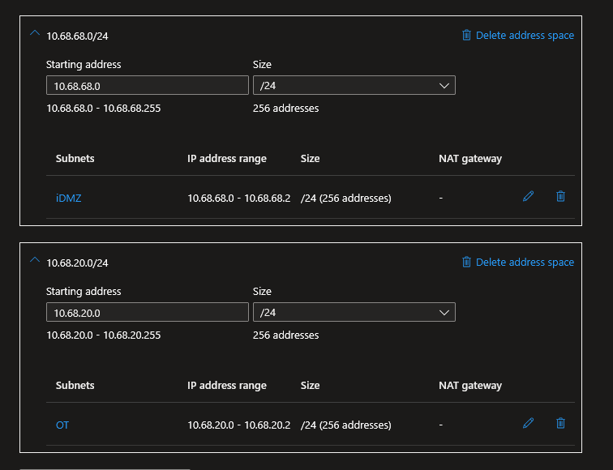

## VM's Azure Retirement of default outbound access: scope and impact

That is correct. Microsoft has shifted default outbound access to restricted/disabled for new virtual machines in Azure.

When a VM does not have explicit outbound connectivity configured—such as through an Azure NAT Gateway, a load balancer with outbound rules, or an explicit public IP with outbound rules configured under the newer security models—it cannot initiate outbound connections to the public internet.

Opening port 8080, 80, and 443 with source "Any" and destination "Any" via a Network Security Group (NSG) rule would bypass your internal caching architecture and expose your nodes directly to the public internet.

Only your controller node (ansiblectr01 at 10.68.68.4) needs direct internet access to pull fresh packages from the public repositories and cache them via apt-cacher-ng.

Adding a public IP address to zabbix01 allows you to access the Zabbix web interface from your browser while keeping outbound internet access blocked via your Network Security Group (NSG) rules.

Yes, exactly. Under Azure's default outbound access policy, assigning a public IP address to a virtual machine (such as zabbix01) does not automatically grant it outbound internet access.

https://learn.microsoft.com/en-us/azure/virtual-network/ip-services/default-outbound-access?tabs=portal

## Virtual machines in Rg-swc-ansiblestack-01

* ansiblectr01, 10.68.68.4, with public ip and allow internet
* azureuser/ ouch no-> imsdal, you know


## Virtual machines in Rg-swc-vms-01

* zabbix01, 10.68.68.5, (with public ip also, but no outbund internet, deny with NSG) later
* mysql01, 10.68.68.52, no outbund internet by default
* zabbix02, 10.68.20.15, no outbund internet by default


# Ansible configuration POC

## Create ansiblectr01 Subnet 1 (iDMZ / Management)

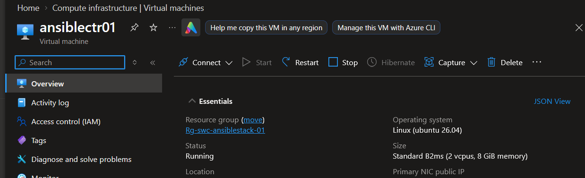

## Install Ansible on ansiblectr01


ansiblectr01 | Network settings Outbund port rule added

Allow_internet

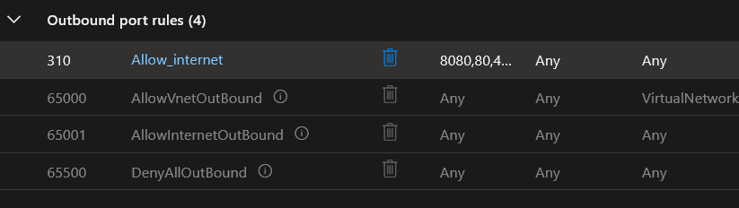

10.68.68.4

```bash

azureuser@ansiblectr01

sudo apt update
sudo apt install software-properties-common
sudo add-apt-repository --yes --update ppa:ansible/ansible
sudo apt install ansible

# install
sudo apt install ansible

# check v
ansible --version
```
Log

```console
ansible [core 2.21.5]
  config file = /etc/ansible/ansible.cfg
  configured module search path = ['/home/azureuser/.ansible/plugins/modules', '/usr/share/ansible/plugins/modules']
  ansible python module location = /usr/lib/python3/dist-packages/ansible
  ansible collection location = /home/azureuser/.ansible/collections:/usr/share/ansible/collections
  executable location = /usr/bin/ansible
  python version = 3.14.4 (main, Aug 20 2026, 10:41:58) [GCC 15.2.0] (/usr/bin/python3)
  jinja version = 3.1.6
  pyyaml version = 6.0.3 (with libyaml v0.2.5)
```

https://docs.ansible.com/projects/ansible/latest/installation_guide/installation_distros.html

### Create folder structure

```bash
mkdir io_ot_lab
cd io_ot_lab
mkdir inventory
cd inventory
touch hosts.ini
cd..
mkdir playbooks
touch ansible.cfg

ls
ansible.cfg  inventory  playbooks
```


## Create zabbix01 Subnet 1 (iDMZ / Management)

10.68.68.5

```bash
# ssh into vm
Last login: Wed Nov 11 18:25:27 2026 from 10.68.68.4
azureuser@zabbix01
```

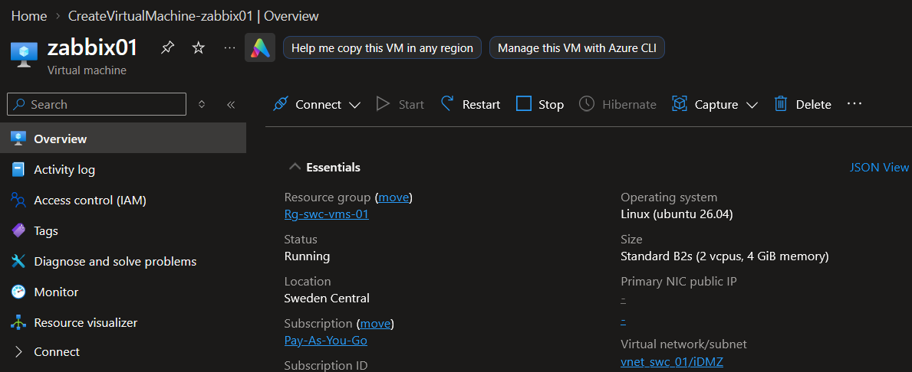

## Populate folder structure and verify ssh

```bash

azureuser@ansiblectr01

cd io_ot_lab/

sudo nano inventory/hosts.ini
```

Configure inventory/hosts.ini

```ini
[ot_nodes]
zabbix01 ansible_host=10.68.68.5 ansible_user=azureuser

[ot_nodes:vars]
ansible_connection=ssh
```

```bash
ansible-inventory -i inventory/hosts.ini --list
```
Verification: Run ansible-inventory -i inventory/hosts.ini --list to ensure Ansible parses the host definition correctly.

```console
azureuser@ansiblectr01:~/io_ot_lab$ ansible-inventory -i inventory/hosts.ini --list
{
    "_meta": {
        "hostvars": {
            "10.68.68.5": {
                "ansible_connection": "ssh",
                "ansible_user": "azureuser"
            }
        },
        "profile": "inventory_legacy"
    },
    "all": {
        "children": [
            "ungrouped",
            "ot_nodes"
        ]
    },
    "ot_nodes": {
        "hosts": [
            "10.68.68.5"
        ]
    }
}
```
Update your root ansible.cfg file to set the default inventory path and disable strict host key checking for lab environments:

```bash
azureuser@ansiblectr01

cd io_ot_lab/

sudo nano ansible.cfg
```

```ini
[defaults]
callbacks_enabled = profile_tasks, timer
inventory = inventory/hosts.ini
host_key_checking = False
retry_files_enabled = False
interpreter_python = auto_silent
```

```bash

#  Verification: Run ansible-config view to confirm the active configuration.
ansible-config

# o view your active ansible.cfg configuration file cleanly, use the view action argument:
ansible-config view

```

### Enable passwordless, secure SSH authentication and log on ansiblectr01 in /opt/ansible

To enable passwordless, secure SSH authentication from your Ansible controller node (ansiblectr01, 10.68.68.4) to your target host (10.68.68.5), you need to generate an SSH key pair on the controller and copy the public key to the remote host.

```bash

azureuser@ansiblectr01

ssh-keygen -t rsa -b 4096 -N "" -f ~/.ssh/id_rsa

ls -la ~/.ssh/id_rsa.pub

# Copy Public Key to Target Node
ssh-copy-id -i ~/.ssh/id_rsa.pub azureuser@10.68.68.5

# ssh login with key no pass
ssh azureuser@10.68.68.5

# permission annd access to /opt/ansible
sudo mkdir -p /opt/ansible
sudo chown -R azureuser:azureuser /opt/ansible
```

Lets update the ansible.cfg and add a log path also

```ini
# Version: 1.1.0
# Description: Global Ansible configuration with password-prompted privilege escalation for lab automation.

[defaults]
inventory = ./inventory/hosts.ini
remote_user = azureuser
private_key_file = ~/.ssh/id_rsa
host_key_checking = False
retry_files_enabled = False
stdout_callback = default
log_path = /opt/ansible/automation.log

[privilege_escalation]
become = True
become_method = sudo
become_user = root
become_ask_pass = False
```

## Playbook linux ping_hosts.yml


```bash
azureuser@ansiblectr01

cd io_ot_lab/

sudo nano playbooks/ping_hosts.yml

```

ping_hosts.yml

```yml
---
# Version: 1.0.1
# Description: Ping validation playbook with privilege escalation explicitly disabled

- name: Verify Connectivity Across Purdue Lab Nodes
  hosts: ot_nodes
  gather_facts: false
  become: false
  tasks:
    - name: Ping all inventory hosts
      ansible.builtin.ping:
```


Run it

```bash
ansible-playbook -i inventory/hosts.ini playbooks/ping_hosts.yml
```
log

```console
PLAY [Verify Connectivity Across Purdue Lab Nodes] ******************************************

TASK [Ping all inventory hosts] *************************************************************
[...]
ok: [10.68.68.5]

PLAY RECAP **********************************************************************************
10.68.68.5                 : ok=1    changed=0    unreachable=0    failed=0    skipped=0    rescued=0    ignored=0


```

## Set up apt-cacher-ng and Apache on ansiblectr01


```bash
sudo apt update
sudo apt install -y apt-cacher-ng apache2


```
Allow HTTP tunnels through Apt-Cacher NG? Yes


### Allowed remote repositories

```bash

# Backup the existing configuration file
sudo cp /etc/apt-cacher-ng/acng.conf /etc/apt-cacher-ng/acng.conf.bak

# check what we have first
sudo grep -E "PassThroughPattern|Remap-(ubuntu|ppa|ansible|zabbix)" /etc/apt-cacher-ng/acng.conf

# The grep results show that PassThroughPattern is currently commented out or set to specific defaults, and none of your custom Remap rules are present yet.

# You can safely add your whitelisted repositories and update the PassThroughPattern to allow secure connections.

# Run the following command block to append your repository remapping rules to /etc/apt-cacher-ng/acng.conf:
sudo bash -c 'cat << '\''EOF'\'' >> /etc/apt-cacher-ng/acng.conf

# Ubuntu official mirrors and security updates
Remap-ubuntu: ubuntu.com archive.ubuntu.com security.ubuntu.com ; security.ubuntu.com/ubuntu

# Zabbix official repository
Remap-zabbix: repo.zabbix.com ; repo.zabbix.com/
EOF'

sudo tail -n 15 /etc/apt-cacher-ng/acng.conf

# Append the PassThroughPattern rule to allow secure APT traffic handling:
sudo bash -c 'echo "PassThroughPattern: .*" >> /etc/apt-cacher-ng/acng.conf'

sudo systemctl restart apt-cacher-ng

sudo systemctl status apt-cacher-ng
```


## Playbook linux configure_apt_proxy.yml


```bash
azureuser@ansiblectr01

cd io_ot_lab

sudo nano playbooks/cofigure_apt_proxy.yml


```
configure_apt_proxy.yml

```yml
---
# Version: 1.0.3
# Description: Configures APT HTTP and HTTPS proxy settings for internal caching across nodes.

- name: Configure Internal APT Caching Proxy
  hosts: ot_nodes
  become: true
  tasks:
    - name: Set APT Proxy configuration file
      ansible.builtin.copy:
        dest: /etc/apt/apt.conf.d/01proxy
        content: |
          Acquire::http::Proxy "http://10.68.68.4:3142/ubuntu/";
          Acquire::https::Proxy "http://10.68.68.4:3142/ubuntu/";
        owner: root
        group: root
        mode: '0644'

```

Run it

```bash
azureuser@ansiblectr01

cd io_ot_lab

ansible-playbook -i inventory/hosts.ini playbooks/configure_apt_proxy.yml --check


```

Log

```console
PLAY [Configure Internal APT Caching Proxy] *************************************************

TASK [Gathering Facts] *********************************************************************
[...]

ok: [10.68.68.5]

TASK [Set APT Proxy configuration file] *****************************************************
changed: [10.68.68.5]

PLAY RECAP **********************************************************************************
10.68.68.5                 : ok=2    changed=1    unreachable=0    failed=0    skipped=0    rescued=0    ignored=0
```

The dry-run check mode completed successfully (changed=1, failed=0), confirming that Ansible can connect to your managed node and properly deploy the APT proxy configuration file.


Run it and apply it

```bash
azureuser@ansiblectr01

cd io_ot_lab

# ansible-playbook -i inventory/hosts.ini playbooks/configure_apt_proxy.yml --limit ot_nodes
# or
ansible-playbook -i inventory/hosts.ini playbooks/configure_apt_proxy.yml --limit zabbix01

```

log

```console
PLAY [Configure Internal APT Caching Proxy] *************************************************

TASK [Gathering Facts] **********************************************************************

[...]
TASK [Set APT Proxy configuration file] *****************************************************
changed: [zabbix01]

PLAY RECAP **********************************************************************************
zabbix01                   : ok=2    changed=1    unreachable=0    failed=0    skipped=0    rescued=0    ignored=0
```
### Veriy manual update on zabbix01


```bash
ssh azureuser@10.68.68.5

sudo apt update

sudo apt upgrade

```

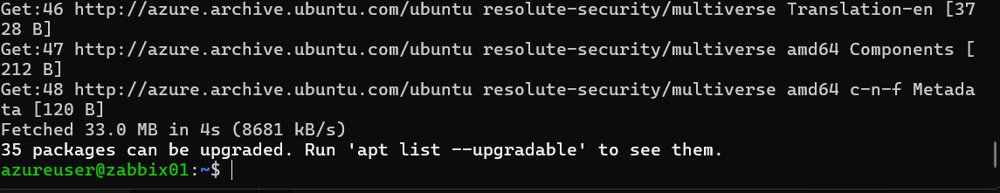

Stop the apt cacher ng and verify no updates possible on zabbix01

```bash
azureuser@ansiblectr01

sudo systemctl stop apt-cacher-ng

ssh azureuser@10.68.68.5
```

No updates

The Connection refused error on port 3142 confirms that zabbix01 is actively trying to route its package updates through your controller's proxy, but the proxy service is currently stopped or unreachable.

Yes, exactly. The connection refusal error when the proxy service was stopped—followed by the successful package fetch once started—proves that zabbix01 relies entirely on your internal proxy (ansiblectr01 at 10.68.68.4:3142) for package updates.

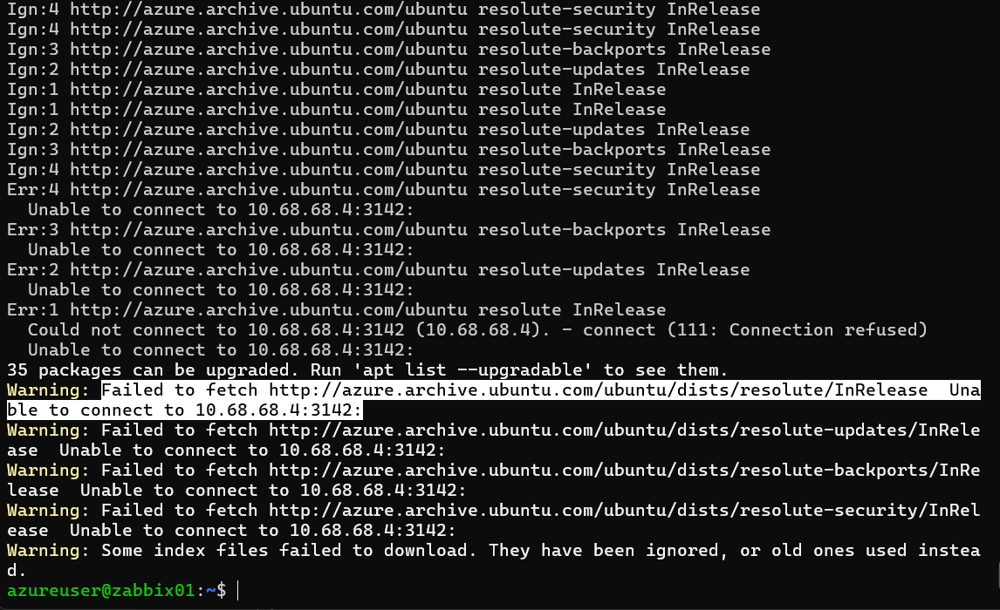


## Playbook linux update_apt.yml with callbacks_enabled = profile_tasks, timer

```bash
azureuser@ansiblectr01:~/io_ot_lab
sudo nano playbooks/update_apt.yml

```

update_apt.yml

```yml
---
# Version: 1.0.0
# Description: Updates package cache and safely upgrades system packages across managed nodes using the APT proxy.

- name: Update and Upgrade System Packages
  hosts: ot_nodes
  become: true
  tasks:
    - name: Update apt repository cache
      ansible.builtin.apt:
        update_cache: true
        cache_valid_time: 3600

    - name: Perform a safe upgrade of installed packages
      ansible.builtin.apt:
        upgrade: safe
```
run it

```bash
ansiblectr01

cd io_ot_lab/

ansible-playbook -i inventory/hosts.ini playbooks/update_apt.yml --limit zabbix01 --check

# if the play is ok, remove --check with --diff and or --limit
ansible-playbook -i inventory/hosts.ini playbooks/update_apt.yml --limit zabbix01

```

log

```console
PLAY [Update and Upgrade System Packages] ***************************************************

TASK [Gathering Facts] **********************************************************************
Wednesday 11 November 2026  20:04:56 +0000 (0:00:00.014)       0:00:00.014 ****
ok: [zabbix01]

TASK [Update apt repository cache] **********************************************************
Wednesday 11 November 2026  20:04:58 +0000 (0:00:01.995)       0:00:02.010 ****
ok: [zabbix01]

TASK [Perform a safe upgrade of installed packages] *****************************************
Wednesday 11 November 2026  20:04:59 +0000 (0:00:00.897)       0:00:02.907 ****
ok: [zabbix01]

PLAY RECAP **********************************************************************************
zabbix01                   : ok=3    changed=0    unreachable=0    failed=0    skipped=0    rescued=0    ignored=0


TASKS RECAP *********************************************************************************
Wednesday 11 November 2026  20:05:00 +0000 (0:00:01.239)       0:00:04.147 ****
===============================================================================
Gathering Facts ---------------------------------------------------------------------- 2.00s
Perform a safe upgrade of installed packages ----------------------------------------- 1.24s
Update apt repository cache ---------------------------------------------------------- 0.90s

PLAYBOOK RECAP ******************************************************************************
Playbook run took 0 days, 0 hours, 0 minutes, 4 seconds
```

Now we have more output for time and date and more.


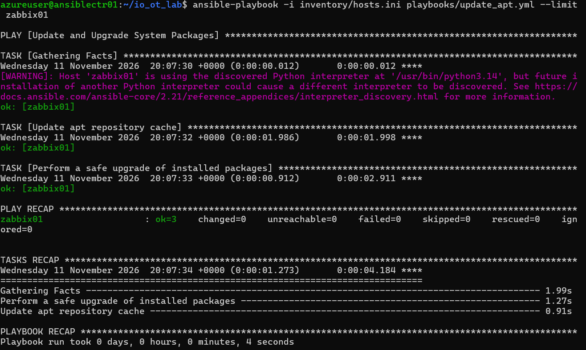


## Current vms

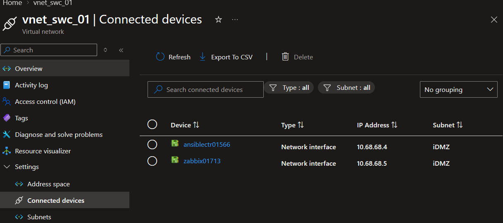


# Semaphore UI POC

## Install Semaphore UI on ansiblectr01 with SQLite

### We could do it with Ansible playbook also/ this is manual install to get to know it

To install Ansible Semaphore (a modern UI for Ansible) on your ansiblectr01 node, you can run Semaphore as a systemd service backed by a database (such as SQLite, which is lightweight and ideal for standalone controller nodes).

```bash
ansiblectr01

wget https://github.com/semaphoreui/semaphore/releases/download/v2.17.15/semaphore_2.17.15_linux_amd64.deb

ls -la semaphore_2.17.15_linux_amd64.deb
-rw-rw-r-- 1 azureuser azureuser 18833690 Feb 27  2026 semaphore_2.17.15_linux_amd64.deb

# Install the downloaded Debian package using dpkg:
sudo dpkg -i semaphore_2.17.15_linux_amd64.deb

# 
semaphore setup

```
1. Follow the interactive prompts to define your database settings, administrator account, and HTTP port.
Verification: Check that your configuration file (or database) has been created successfully in the directory specified during setup.

```txt

Sqlite

Configuration path: Press Enter to accept the default or specify /etc/semaphore/config.json.

Database dialect: Choose sqlite3.

Path to SQLite database: Specify /home/azureuser/io_ot_lab/semaphore.db

Path to Playbooks: Point this directly to your lab directory (/home/azureuser/io_ot_lab/playbooks).

Admin account details: Enter your desired username, email, and password for accessing the web UI.
```

2. Configure SQLite and Paths

Review your generated configuration file (for example, in your project folder or /etc/semaphore/config.json) to confirm that the SQLite database path and your Ansible playbook directories are correctly mapped:


```bash
ansiblectr01

ls
ansible.cfg  config.json  inventory  playbooks  semaphore.db

# check you config
cat config.json
```
Your config.json is missing the playbook_path and port keys required for Semaphore to locate your playbooks and serve the web interface. Update your config.json file to include them.

```bash
sudo nano config.json

```
Added

```json
"playbook_path": "/home/azureuser/io_ot_lab/playbooks",
        "port": "3000",
```
Rerun validation

```bash
semaphore setup --config /home/azureuser/io_ot_lab/config.json

# check all steps


```

Create service file

```bash
# Create the Systemd Service File
sudo nano /etc/systemd/system/semaphore.service
```

file

```ini
[Unit]
Description=Semaphore UI Ansible Automation Server
After=network.target

[Service]
User=azureuser
WorkingDirectory=/home/azureuser/io_ot_lab
ExecStart=/usr/bin/semaphore server --config /home/azureuser/io_ot_lab/config.json
Restart=always
RestartSec=5

[Install]
WantedBy=multi-user.target
```
Reload it

```bash
# Reload systemd to recognize or update the service configuration, then start and enable Semaphore:
sudo systemctl daemon-reload
sudo systemctl enable --now semaphore.service

sudo systemctl status semaphore.service
● semaphore.service - Semaphore UI Ansible Automation Server
     Loaded: loaded (/etc/systemd/system/semaphore.service; enabled; preset: enabled)
     Active: active (running) since Wed 2026-11-11 20:27:17 UTC; 9s ago
```

### Accessing Semaphore UI


Add allow in semaphore 3000 tcp, NSG.


https://semaphoreui.com/docs/admin-guide/installation/package-manager


https://semaphoreui.com/


URL: [http://10.68.68.4:3000](http://10.68.68.4:3000) (or via your controller's accessible IP/port)


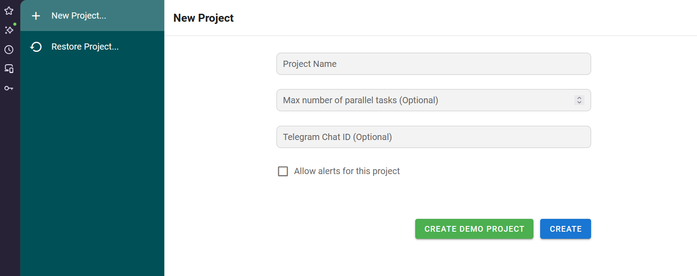

### SSL/TLS Certificates


```bash
sudo openssl req -x509 -nodes -days 3650 -newkey rsa:2048 \
  -keyout /home/azureuser/io_ot_lab/semaphore.key \
  -out /home/azureuser/io_ot_lab/semaphore.crt \
  -subj "/CN=10.68.68.4"

sudo chown azureuser:azureuser /home/azureuser/io_ot_lab/semaphore.key /home/azureuser/io_ot_lab/semaphore.crt
chmod 600 /home/azureuser/io_ot_lab/semaphore.key

sudo nano config.json
```

Update your /home/azureuser/io_ot_lab/config.json to include the certificate and key paths:

```json
"tls_cert": "/home/azureuser/io_ot_lab/semaphore.crt",
        "tls_key": "/home/azureuser/io_ot_lab/semaphore.key",
```

```bash
sudo systemctl restart semaphore.service
sudo systemctl status semaphore.service
```


Enable service

```bash
sudo nano /etc/systemd/system/semaphore.service
```

```ini

[Unit]
[Unit]
Description=Semaphore UI Ansible Automation Server
After=network.target

[Service]
User=azureuser
WorkingDirectory=/home/azureuser/io_ot_lab
ExecStart=/usr/bin/semaphore server --config /home/azureuser/io_ot_lab/config.json
Restart=always
RestartSec=5

[Install]
WantedBy=multi-user.target

```

```bash
sudo systemctl daemon-reload
sudo systemctl restart semaphore.service

 sudo systemctl status semaphore.service
● semaphore.service - Semaphore UI Ansible Automation Server
     Loaded: loaded (/etc/systemd/system/semaphore.service; enabled; preset: enabled)
     Active: active (running) since Wed 2026-11-11 20:42:22 UTC; 1min 23s ago
```

###  Apache in front of Semaphore for secure HTTPS access


```bash
 sudo systemctl status apache2.service
● apache2.service - The Apache HTTP Server
     Loaded: loaded (/usr/lib/systemd/system/apache2.service; enabled; preset: enabled)
     Active: active (running) since Wed 2026-11-11 19:09:00 UTC; 1h 50min ago

# Enable Apache's proxy, proxy_http, ssl, and rewrite modules required for handling reverse proxying and SSL termination:
sudo a2enmod proxy proxy_http ssl rewrite headers

sudo nano /etc/apache2/sites-available/semaphore.conf
```

Use public ip not x.xxx.xx.x
```txt
<VirtualHost *:443>
    ServerName x.xx.xx.x

    SSLEngine on
    SSLCertificateFile /home/azureuser/io_ot_lab/semaphore.crt
    SSLCertificateKeyFile /home/azureuser/io_ot_lab/semaphore.key

    ProxyPreserveHost On
    ProxyRequests Off

    # Proxy traffic to Semaphore running on plain HTTP port 3000
    ProxyPass / http://127.0.0.1:3000/
    ProxyPassReverse / http://127.0.0.1:3000/

    # WebSocket support for live playbook logs
    RewriteEngine On
    RewriteCond %{HTTP:Upgrade} =websocket [NC]
    RewriteRule /(.*)  ws://127.0.0.1:3000/$1 [P,L]
    RewriteCond %{HTTP:Upgrade} !=websocket [NC]
    RewriteRule /(.*)  http://127.0.0.1:3000/$1 [P,L]

    ErrorLog ${APACHE_LOG_DIR}/semaphore_error.log
    CustomLog ${APACHE_LOG_DIR}/semaphore_access.log combined
</VirtualHost>
```
Enable the Apache Site and Restart Service

```bash
sudo a2ensite semaphore.conf
sudo a2dissite 000-default.conf
sudo apache2ctl configtest
sudo systemctl restart apache2

# Verification: The config test returns Syntax OK, and sudo systemctl status apache2 shows active (running).
sudo systemctl status apache2.service
● apache2.service - The Apache HTTP Server
     Loaded: loaded (/usr/lib/systemd/system/apache2.service; enabled; preset: enabled)
     Active: active (running) since Wed 2026-11-11 21:01:03 UTC; 24s ago
```

Check your Inbound port rules to ensure there is a rule allowing TCP traffic on Port 443 from any source (or your client IP) to any destination.
Verification: If port 443 is missing, click Add inbound port rule, set destination port ranges to 443, protocol to TCP, action to Allow, and save.


Validity
Not Before
Wed, 11 Nov 2026 20:33:20 GMT
Not After
Sat, 08 Nov 2036 20:33:20 GMT 


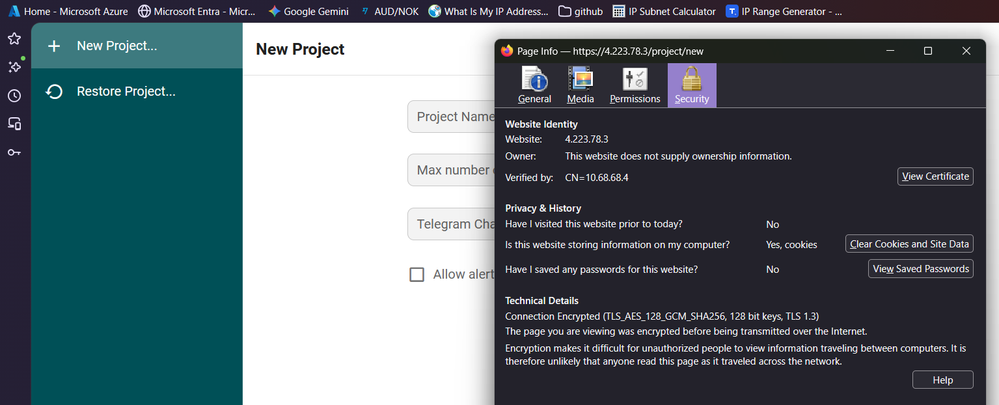

now that Apache is handling SSL termination on port 443 and securely proxying traffic to Semaphore locally, you should clean up and close port 3000 in your Azure Network Security Group (NSG) so external traffic is forced through the secure HTTPS proxy.

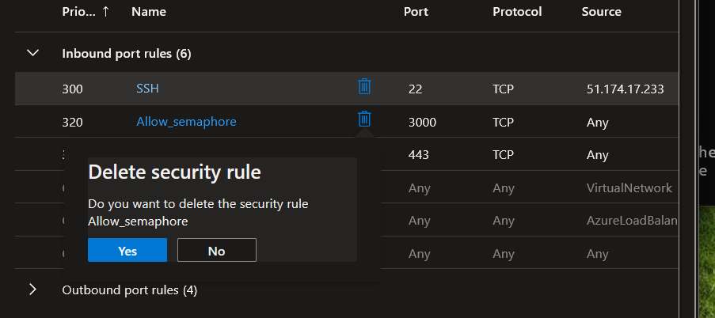

https://www.sslshopper.com/ssl-checker.html

Yes we use a self signed cert.

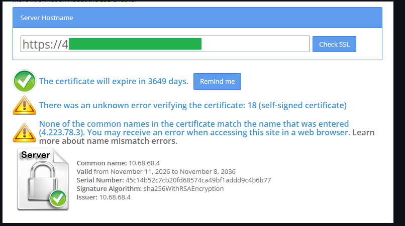


## Setup Ansible ansiblectr01 with Semaphore

* Playbooks live locally: You write, edit, and store your .yml playbook files directly in your local directory on the controller node (/home/azureuser/io_ot_lab/playbooks/).
* Semaphore links to them: Semaphore reads those local files (or your connected Git repository) and provides the buttons, access keys, inventory mappings, and web triggers to execute them.

Next Steps in the Web Interface

Log into Semaphore, click New Project, enter IO-OT Lab as the project name, and click Create.
Verification: You are redirected to the new project dashboard view.

🔵 Add Repository: Point Semaphore to your local playbook directory or a Git repository if applicable.

🔵 Add Inventory: Define your inventory path (inventory/hosts.ini).

🔵 Add Environment / Access Keys: Configure your SSH private key so Semaphore can authenticate against your managed nodes (zabbix01, mysql01, zabbix02).

🔵 Create Templates: Link your playbooks (configure_apt_proxy.yml, update_apt.yml) to templates for easy execution directly from the dashboard

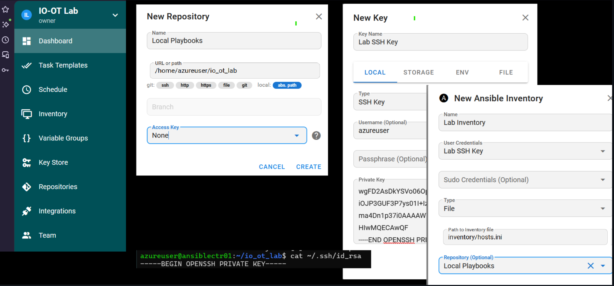


## Playbooks linux Semaphore run

What to Do Next

To start running your automation tasks, you can proceed with creating your execution templates:

* Create Templates: Go to Templates in your Semaphore dashboard and link your playbooks (ping_hosts.yml, update_apt.yml, configure_apt_proxy.yml) to your Lab Inventory and Lab SSH Key.

* Run and Test: Trigger a run directly from the dashboard to verify that Semaphore successfully executes your playbooks against your lab nodes over SSH.


### linux ping_hosts.yml

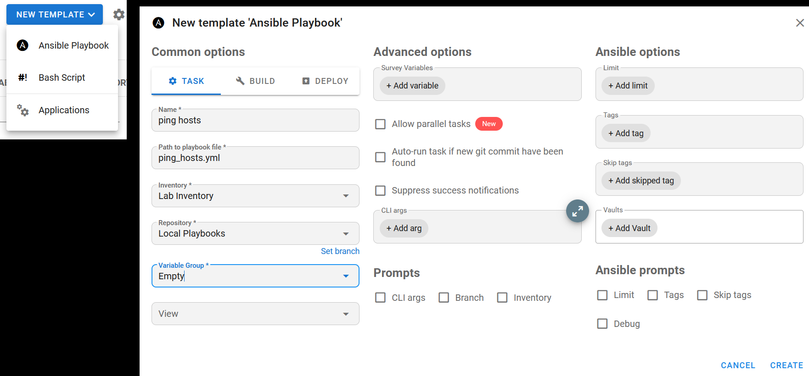

Run the playbook

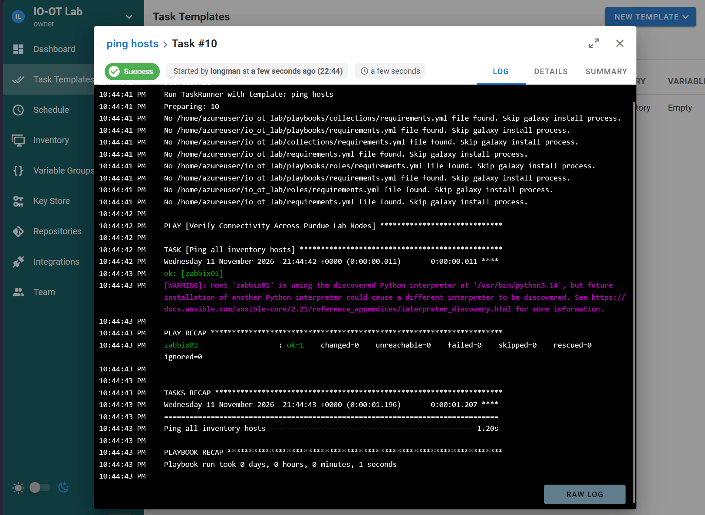

Verify in Semaphore

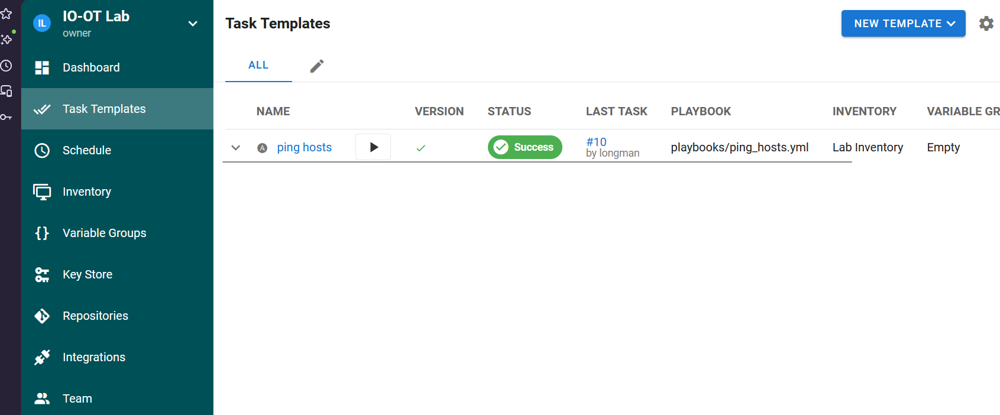

### linux update_apt.yml

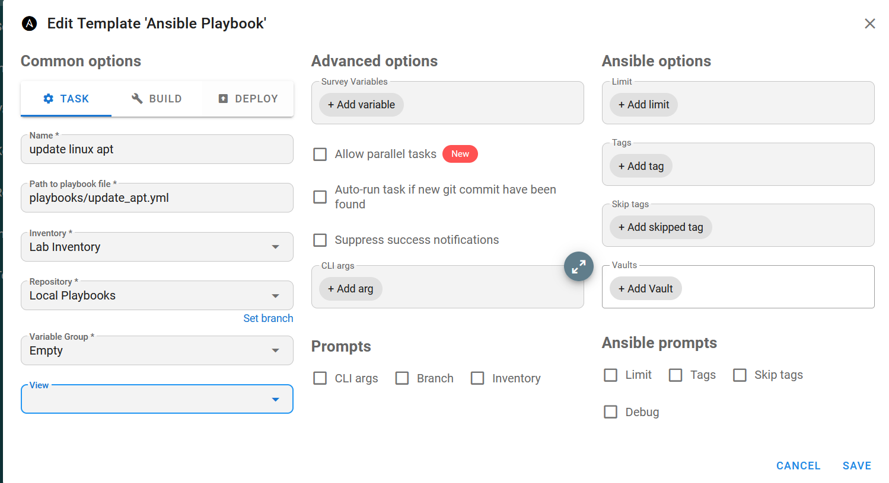

Success, we updated zabbix01


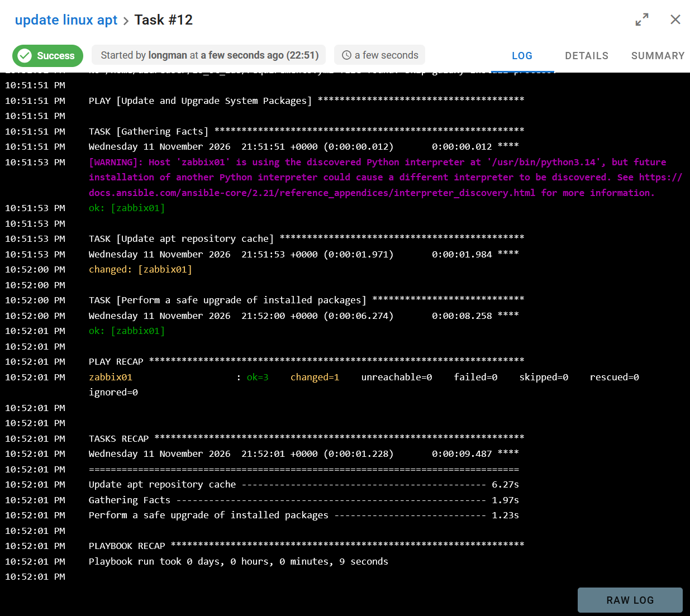


Success


Status for playbooks

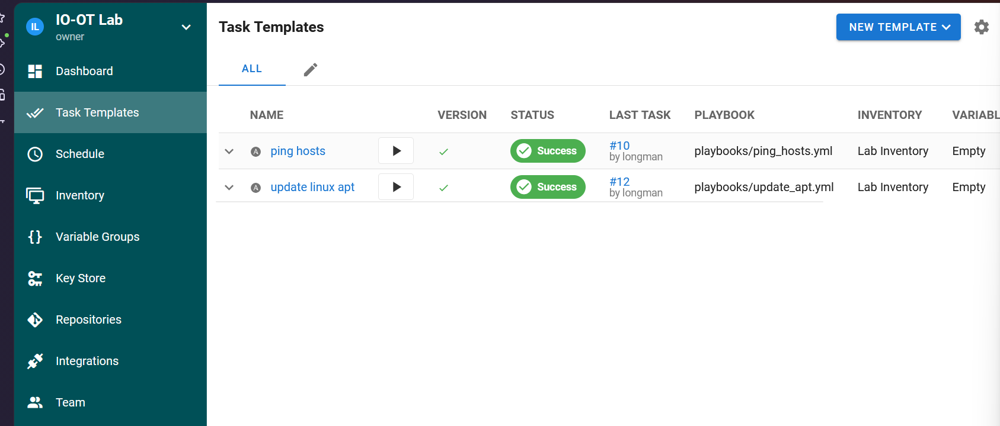


# 2. Topology at this stage

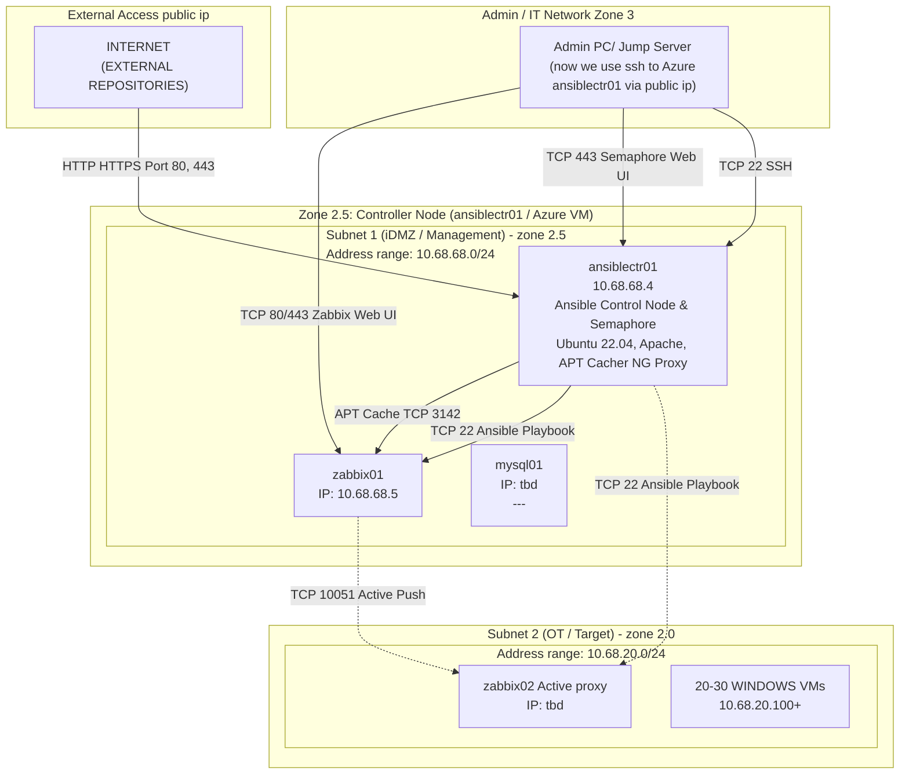

This is the final set up (ip may change but the concept is the same)


# Set up the rest of the stack

## Create mysql01 and zabbix02

* Create mysql01 and add a extra datadisk with 32 GB


Vm mysql01 created 10.68.68.6

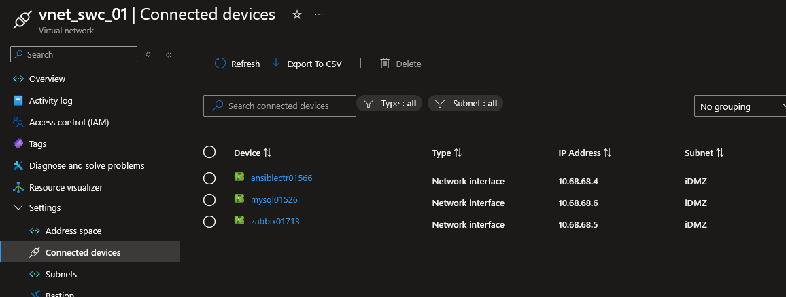

* Create zabbix02

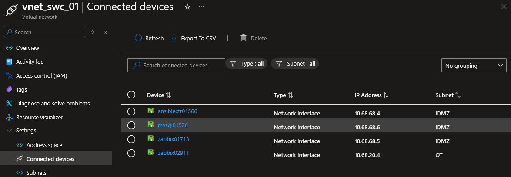

Azure vms

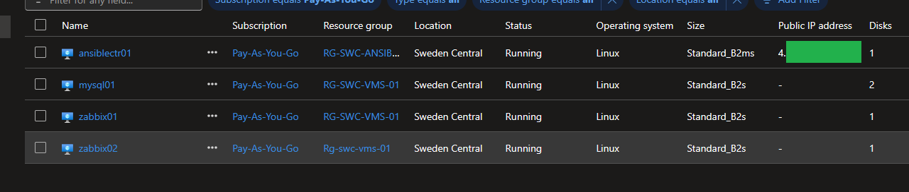

## No outbound to internet

Vms

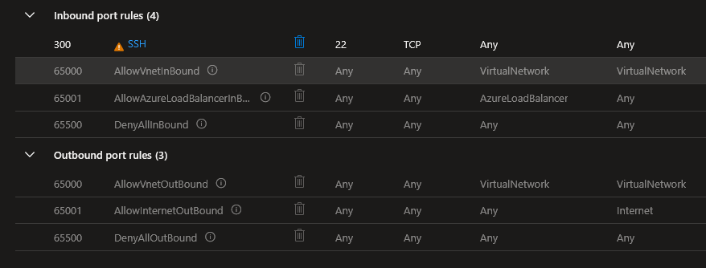

Ansible

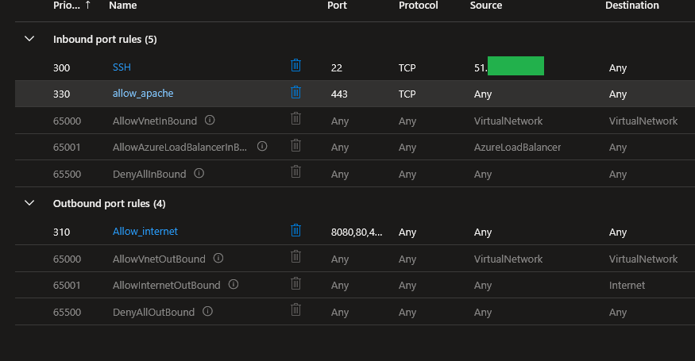

## Structure inventory/hosts.ini and align all configurations

```ini
[idmz_nodes]
zabbix01 ansible_host=10.68.68.5 ansible_user=azureuser  ansible_python_interpreter=/usr/bin/python3.14
mysql01 ansible_host=10.68.68.6 ansible_user=azureuser  ansible_python_interpreter=/usr/bin/python3.14

[ot_nodes]
zabbix02 ansible_host=10.68.20.4 ansible_user=azureuser

[idmz_nodes:vars]
ansible_connection=ssh

[ot_nodes:vars]
ansible_connection=ssh

[all:vars]
ansible_python_interpreter=auto_silent


```

### Add ssh keys for new hosts

```bash

# Copy SSH Public Key to mysql01
ssh-copy-id -i ~/.ssh/id_rsa.pub azureuser@10.68.68.6

ssh azureuser@10.68.68.6

# Copy SSH Public Key to zabbix02
ssh-copy-id -i ~/.ssh/id_rsa.pub azureuser@10.68.20.4

ssh azureuser@10.68.20.4
```

### Playbook linux yml update hosts and verify current templates

Update all templates with more hosts since we have added.

hosts: ot_nodes

Update

hosts: ot_nodes:idmz_nodes
```yml
---
# Version: 1.0.1
# Description: Ping validation playbook with privilege escalation explicitly disabled

- name: Verify Connectivity Across Purdue Lab Nodes
  hosts: ot_nodes:idmz_nodes
```

Run it

```bash
azureuser@ansiblectr01:~/io_ot_lab

ansible-playbook -i inventory/hosts.ini playbooks/ping_hosts.yml
```

log

```console
PLAY [Verify Connectivity Across Purdue Lab Nodes] *********************************************************************

TASK [Ping all inventory hosts] ****************************************************************************************
Thursday 12 November 2026  08:51:31 +0000 (0:00:00.011)       0:00:00.011 *****
ok: [mysql01]
ok: [zabbix01]
ok: [zabbix02]

PLAY RECAP *************************************************************************************************************
mysql01                    : ok=1    changed=0    unreachable=0    failed=0    skipped=0    rescued=0    ignored=0
zabbix01                   : ok=1    changed=0    unreachable=0    failed=0    skipped=0    rescued=0    ignored=0
zabbix02                   : ok=1    changed=0    unreachable=0    failed=0    skipped=0    rescued=0    ignored=0


TASKS RECAP ************************************************************************************************************
Thursday 12 November 2026  08:51:32 +0000 (0:00:01.167)       0:00:01.178 *****
===============================================================================
Ping all inventory hosts ---------------------------------------------------------------------------------------- 1.17s

PLAYBOOK RECAP *********************************************************************************************************
Playbook run took 0 days, 0 hours, 0 minutes, 1 seconds
```

## Run linux ping_hosts.yml Semaphore

It automatically picks up all our new hosts.

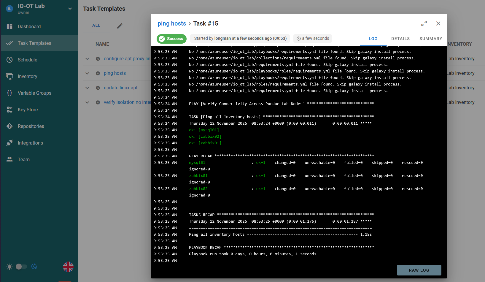

### Playbook Linux verify_firewall_isolation.yml

verify isolation no internet for linux

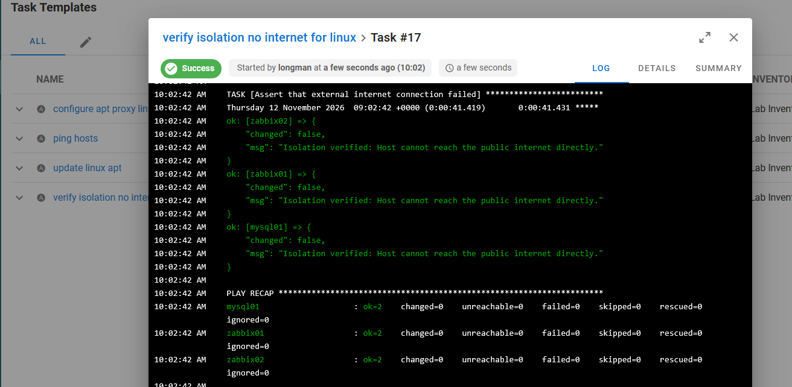


### Playbook Linux configure_apt_proxy.yml

Now run cofigure proxy to apply to new nodes

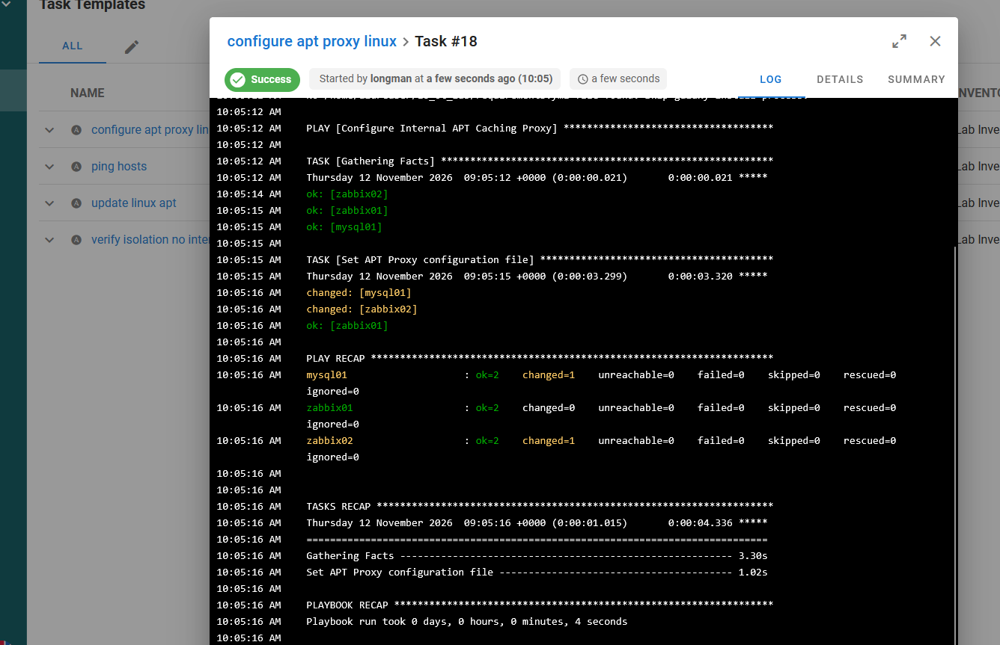


### Playbook Linux update_apt.yml patch all hosts with one click

Now update all servers with the apt playbook.

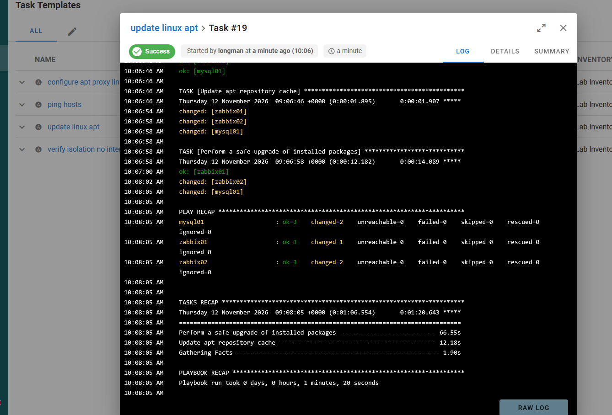


All Playbooks are success and ready

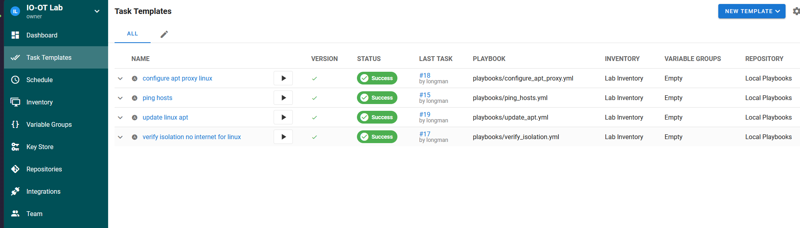


## Playbook Configure a Dedicated Template per Host/Group (Recommended) in Semaphore

```bash
# ansible we can run
azureuser@ansiblectr01:~/io_ot_lab

# all vms
ansible-playbook -i inventory/hosts.ini playbooks/configure_apt_proxy.yml

# just one
ansible-playbook -i inventory/hosts.ini playbooks/configure_apt_proxy.yml --limit zabbix01
```
In Semaphore, templates are designed to be reusable workflows. Rather than manually typing --limit every time, the cleanest approach is to create distinct templates mapped to specific inventory groups or hosts:

1. Go to Templates and click New Template.

2. Name it something descriptive, such as Update APT - zabbix01 only.

3. Select your playbook (playbooks/update_apt.yml).

4. Select your Inventory (hosts.ini).

5. In the Limit field provided by Semaphore's template settings, enter your specific host or group name (e.g., zabbix01 or ot_nodes).

6. Click Save.

Verification: Launching this template automatically applies the limit without requiring manual command-line flags.

## Semaphore statistic


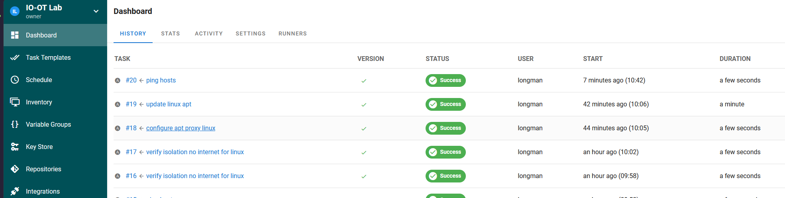

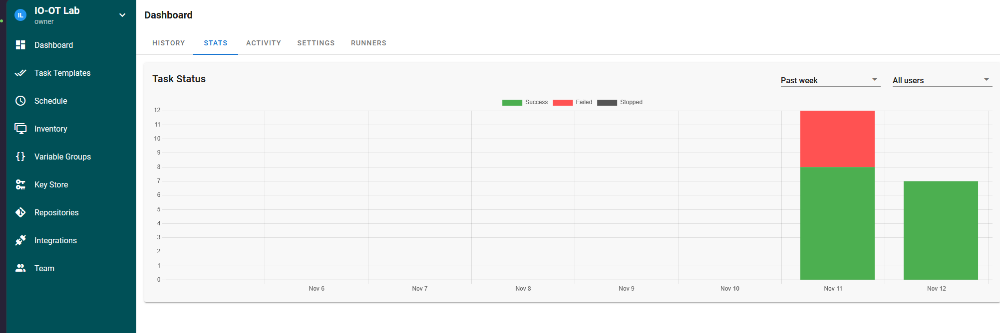


Semaphore does not include a real-time monitoring dashboard or continuous health-status tracking for hosts. Because Semaphore is an automation and orchestration platform rather than a monitoring system, it evaluates host status based on playbook execution results.

Host statuses and health are tracked and viewed in Semaphore through specific mechanisms:

* Task Execution Recaps: Every time you run a playbook template (such as ping_hosts.yml or update_apt.yml), Semaphore captures the standard Ansible output. In the task log, you can view the PLAY RECAP for every run, which explicitly reports whether each host returned ok, changed, unreachable, or failed.

* Inventory Inspection: You can view your configured static inventory (hosts.ini) and check which hosts are mapped under your projects, but this displays configuration definitions rather than live operational metrics.

For continuous real-time host status, performance metrics, and alerting in your lab architecture, that role is handled by your Zabbix infrastructure (zabbix01 and zabbix02), while Semaphore handles running on-demand or scheduled automation playbooks.

# Playbooks with Ansible (Now we can really start)

Now all the configuration and setup is done

* ssh works
* Ping works
* Linux updates with apt cacher ng works
* All nodes are isolated with no internet access

# 3. Topology at this stage

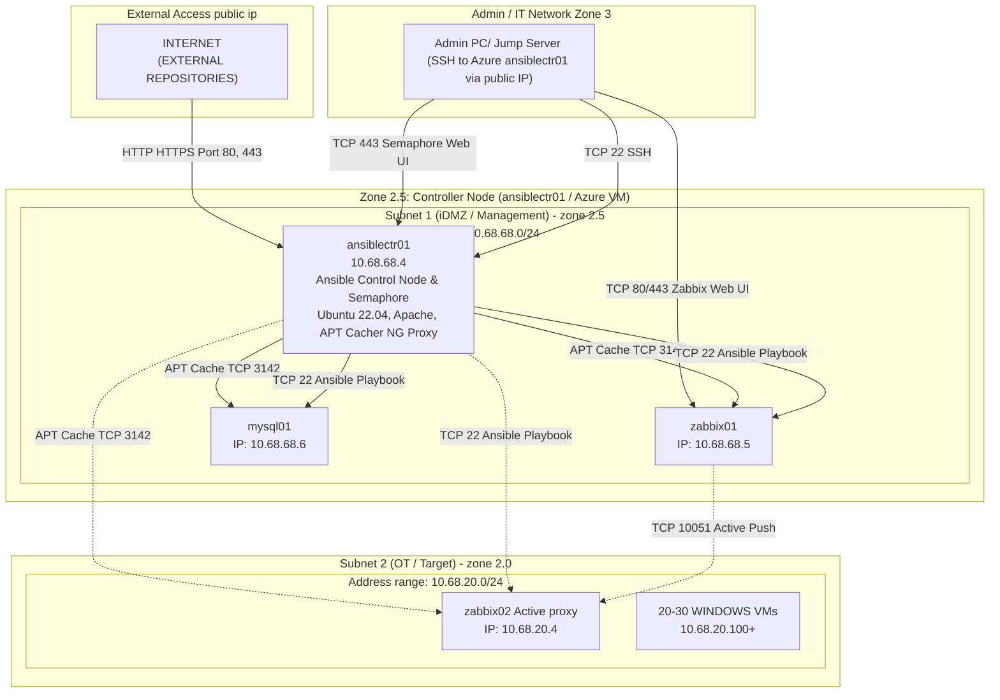


## Update inventory/host.ini


```ini
# Version: 2.0.0
# Description: Multi-zone Ansible static inventory defining topological zones, functional roles, and connection parameters.

[control_node]
ansiblectr01 ansible_host=10.68.68.4 ansible_user=azureuser ansible_python_interpreter=/usr/bin/python3.14 ansible_connection=local

[idmz_nodes]
zabbix01 ansible_host=10.68.68.5 ansible_user=azureuser ansible_python_interpreter=/usr/bin/python3.14
mysql01 ansible_host=10.68.68.6 ansible_user=azureuser ansible_python_interpreter=/usr/bin/python3.14

[ot_nodes]
zabbix02 ansible_host=10.68.20.4 ansible_user=azureuser

[db_servers]
mysql01 ansible_host=10.68.68.6 ansible_user=azureuser ansible_python_interpreter=/usr/bin/python3.14

[zabbix_servers]
zabbix01 ansible_host=10.68.68.5 ansible_user=azureuser ansible_python_interpreter=/usr/bin/python3.14

[zabbix_proxies]
zabbix02 ansible_host=10.68.20.4 ansible_user=azureuser ansible_python_interpreter=/usr/bin/python3.14

[idmz_nodes:vars]
ansible_connection=ssh

[ot_nodes:vars]
ansible_connection=ssh

[all:vars]
ansible_python_interpreter=auto_silent

[io_ot_lab:children]
idmz_nodes
ot_nodes
```

🔵 [control_node]: Groups the local Ansible controller node so that playbooks can execute locally via loopback connections without unnecessary network overhead.

🔵 [idmz_nodes]: Groups all internal Demilitarized Zone management servers together to manage shared security policies and local software repositories cleanly.

🔵 [ot_nodes]: Groups all Operational Technology network targets together to isolate industrial systems from management traffic boundaries.

🔵 [db_servers]: Groups database instances like MySQL so database-specific deployment and tuning playbooks target only relational storage hosts.

🔵 [zabbix_servers]: Groups core Zabbix monitoring servers together to target application-specific updates and configuration management tasks.

🔵 [zabbix_proxies]: Groups Zabbix proxy nodes to streamline data collection routing across segregated network boundaries.

🔵 [idmz_nodes:vars]: Assigns shared SSH connection parameters specifically to management zone hosts to guarantee correct remote transport behavior.

🔵 [ot_nodes:vars]: Applies specific OT network connection settings to target nodes to enforce appropriate transport rules across firewalls.

🔵 [all:vars]: Defines global variables inherited across every inventory host to ensure uniform Python interpreter settings without redundant configuration.

🔵[io_ot_lab:children]: Combines multiple sub-groups into a unified parent group to let you run playbooks across the entire laboratory infrastructure with a single target reference.

## Playbook get_linux_version.yml

```bash

ansible-playbook -i inventory/hosts.ini playbooks/get_linux_version.yml
```


## Playbook linux mount_datadrive_check.yml


Now we can use the mapping in hosts.ini to only target our host in the playbook.

🔵 [db_servers]: Groups database instances like MySQL so database-specific deployment and tuning playbooks target only relational storage hosts.

🔵 you can target the group db_servers directly since mysql01 is already a member of that group

```bash
azureuser@ansiblectr01:~/io_ot_lab

cd io_ot_lab/

# if the play is ok, remove --check with --diff and or --limit

ansible-playbook -i inventory/hosts.ini playbooks/mount_datadrive_check.yml

```

log

```console
PLAY [Check mount secondary data drive] ********************************************************************************

TASK [Gathering Facts] *************************************************************************************************
Sunday 15 November 2026  10:59:57 +0000 (0:00:00.011)       0:00:00.011 *******
ok: [mysql01]

TASK [Gather block device information] *********************************************************************************
Sunday 15 November 2026  10:59:59 +0000 (0:00:01.269)       0:00:01.281 *******
ok: [mysql01]

TASK [Display available block devices] *********************************************************************************
Sunday 15 November 2026  10:59:59 +0000 (0:00:00.535)       0:00:01.816 *******
ok: [mysql01] => {
    "msg": [
        "NAME     SIZE FSTYPE MOUNTPOINTS",
        "sda       30G        ",
        "├─sda1  28.9G ext4   /",
        "├─sda13 1023M ext4   /boot",
        "├─sda14    4M        ",
        "└─sda15  106M vfat   /boot/efi",
        "sdb        8G        ",
        "└─sdb1     8G ext4   /mnt",
        "sdc       16G        "
    ]
}

PLAY RECAP *************************************************************************************************************
mysql01                    : ok=3    changed=0    unreachable=0    failed=0    skipped=0    rescued=0    ignored=0


TASKS RECAP ************************************************************************************************************
Sunday 15 November 2026  10:59:59 +0000 (0:00:00.027)       0:00:01.843 *******
===============================================================================
Gathering Facts ------------------------------------------------------------------------------------------------- 1.27s
Gather block device information --------------------------------------------------------------------------------- 0.54s
Display available block devices --------------------------------------------------------------------------------- 0.03s

PLAYBOOK RECAP *********************************************************************************************************
Playbook run took 0 days, 0 hours, 0 minutes, 1 seconds

```

# 1. Manually attach a data disk to a Linux VM UUID

This step is very risky to automate, we muste make sure that.

1. A disk is avaliable and we must find it
2. The disk we shall format must never be OS disk
3. It must hardcoded with UUID in fstab so it survies boot
4. The name will be datadrive1
5. Then do a boot to verify

https://learn.microsoft.com/en-us/azure/virtual-machines/linux/attach-disk-portal?tabs=scsi

# 1.1 Playbook linux mount_datadrive_for_mysql.yml (risky Azure spesific)


Take a snapshot of the OS disk.

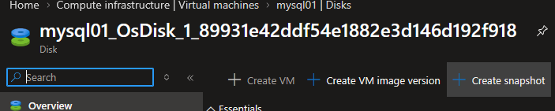

Snap done, we have it at the bottom.

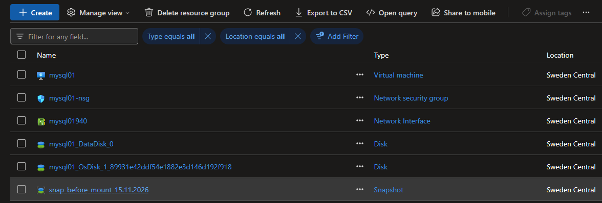


We need to dynamically find the target disk based on size and mount it to /mnt/datadrive1

Lets do this in steps

1. A disk is avaliable and we must find it
2. The disk we shall format must never be OS disk
3. It must hardcoded with UUID in fstab so it survies boot
4. The name will be datadrive1
5. Then do a boot to verify


```bash
azureuser@ansiblectr01:~/io_ot_lab

cd io_ot_lab/

# if the play is ok, remove --check with --diff and or --limit

ansible-playbook -i inventory/hosts.ini playbooks/mount_datadrive.yml --check NA

```

The error occurred because you ran the playbook with the --check (dry run) flag. When running in check mode, Ansible simulates the partitioning task (parted), but it does not actually create /dev/sda1 on the system.


## 1.2 Jinja2 expression is extremely close to a generic template

Yes, the loop-free Jinja2 expression is extremely close to a generic template, but with one hardcoded detail—reject('in', ['sda', 'sdb'])—it is currently Azure-specific rather than truly hypervisor-agnostic.

Here is an analysis of how it behaves and how to make it a true generic template that works across KVM, VMware, AWS, and Azure.


Here is an analysis of how it behaves and how to make it a true generic template that works across KVM, VMware, AWS, and Azure.

The Catch with Cross-Platform Reuse

* Azure Naming: Uses sda for the OS root disk and sdb for the ephemeral temp storage drive, leaving sdc as your secondary data drive. Hardcoding ['sda', 'sdb'] works perfectly here.
* KVM / Proxmox / OpenStack Naming: Often uses VirtIO disks (vda, vdb) where vda is the OS root, or NVMe naming (nvme0n1). If you run an Azure-tuned template on a KVM host where vda is root, hardcoding sda/sdb means the filter won't recognize vda as the root device, risking a critical mis-selection.


We create two playbooks

* mount_datadrive_for_mysql_azure.yml

* mount_datadrive_for_mysql_generic_hyperv.yml

This shall work on all, but we focus first on the azure template and when that works we do the same exercies and focus on the generic one.

So we need to restore a couple of times.

## 1.3 Add prompt before executing Step 3 ansible.builtin.pause


```yml
    # =========================================================================
    # Interactive Confirmation Prompt before Step 3
    # =========================================================================
    - name: Confirm before proceeding to Step 3 (UUID extraction and mounting)
      ansible.builtin.pause:
        prompt: "Ready to proceed with Step 3: UUID extraction and mounting at /mnt/datadrive1. Enter 'yes' to continue or anything else to abort."
      register: confirmation_input

    - name: Abort playbook if user declined confirmation
      ansible.builtin.fail:
        msg: "Playbook execution aborted by user at Step 3 confirmation."
      when: confirmation_input.user_input | lower != 'yes'
```

#### We can add prompts to semaphore later, let's continue cli

Run without check mode (Live Execution): Since partition creation and formatting are idempotent or intended to apply changes, run the playbook normally without --check.


```bash
ansible-playbook -i inventory/hosts.ini playbooks/mount_datadrive_for_mysql_azure.yml
```

log
```console
azureuser@ansiblectr01:~/ansible-io-ot-lab$ ansible-playbook -i inventory/hosts.ini playbooks/mount_datadrive_for_mysql_azure.yml

PLAY [Configure data disk storage] ************************************************************************************************************************************************

TASK [Gathering Facts] ************************************************************************************************************************************************************
Sunday 15 November 2026  12:28:44 +0000 (0:00:00.012)       0:00:00.012 *******
ok: [mysql01]

TASK [Discover secondary data disk dynamically] ***********************************************************************************************************************************
Sunday 15 November 2026  12:28:46 +0000 (0:00:01.982)       0:00:01.995 *******
ok: [mysql01]

TASK [Fail if secondary data disk could not be dynamically resolved] **************************************************************************************************************
Sunday 15 November 2026  12:28:46 +0000 (0:00:00.052)       0:00:02.047 *******
skipping: [mysql01]

TASK [Display resolved data disk] *************************************************************************************************************************************************
Sunday 15 November 2026  12:28:46 +0000 (0:00:00.028)       0:00:02.076 *******
ok: [mysql01] => {
    "msg": "Successfully resolved secondary data disk: /dev/sdc"
}

TASK [Ensure partition 1 exists on data disk] *************************************************************************************************************************************
Sunday 15 November 2026  12:28:46 +0000 (0:00:00.028)       0:00:02.105 *******
ok: [mysql01]

TASK [Format data partition to ext4 if not already formatted] *********************************************************************************************************************
Sunday 15 November 2026  12:28:47 +0000 (0:00:00.575)       0:00:02.680 *******
ok: [mysql01]

TASK [Confirm before proceeding to Step 3 (UUID extraction and mounting)] *********************************************************************************************************
Sunday 15 November 2026  12:28:48 +0000 (0:00:00.613)       0:00:03.294 *******
[Confirm before proceeding to Step 3 (UUID extraction and mounting)]
Ready to proceed with Step 3: UUID extraction and mounting at /mnt/datadrive1. Enter 'yes' to continue or anything else to abort.:
ok: [mysql01]

TASK [Abort playbook if user declined confirmation] *******************************************************************************************************************************
Sunday 15 November 2026  12:28:49 +0000 (0:00:01.786)       0:00:05.081 *******
[ERROR]: Task failed: Action failed: Playbook execution aborted by user at Step 3 confirmation.

```

### 1.4  Idempotent data disk discovery, partitioning, ext4 formatting, UUID extraction, persistent fstab mounting at /mnt/datadrive1, and reboot verification.

Lets build the fstab step

```bash

ansible-playbook -i inventory/hosts.ini playbooks/mount_datadrive_for_mysql_azure.yml

```
log

```console
PLAY RECAP *************************************************************************************************************
mysql01                    : ok=10   changed=0    unreachable=0    failed=0    skipped=2    rescued=0    ignored=0


TASKS RECAP ************************************************************************************************************
Sunday 15 November 2026  16:48:25 +0000 (0:00:00.478)       0:00:09.354 *******
===============================================================================
Confirm before proceeding to Step 3 (UUID extraction and mounting) ---------------------------------------------- 4.76s
Gathering Facts ------------------------------------------------------------------------------------------------- 1.86s
Ensure partition 1 exists on data disk -------------------------------------------------------------------------- 0.56s
Format data partition to ext4 if not already formatted ---------------------------------------------------------- 0.54s
Ensure datadrive1 mount point directory exists ------------------------------------------------------------------ 0.48s
Get UUID of the data disk partition ----------------------------------------------------------------------------- 0.48s
Ensure persistent mount using UUID in fstab for datadrive1 ------------------------------------------------------ 0.48s
Discover secondary data disk dynamically ------------------------------------------------------------------------ 0.05s
Set fact for disk UUID ------------------------------------------------------------------------------------------ 0.04s
Abort playbook if user declined confirmation -------------------------------------------------------------------- 0.04s
Display resolved data disk -------------------------------------------------------------------------------------- 0.03s
Fail if secondary data disk could not be dynamically resolved --------------------------------------------------- 0.02s

PLAYBOOK RECAP *********************************************************************************************************
Playbook run took 0 days, 0 hours, 0 minutes, 9 seconds

```

Semaphore

We commented this step put, Interactive Confirmation Prompt before Step 3 so we can run it in sempphore also.
Later we will use time with semaphore variables.


Lets inspect the disk

```bash
# we use our check playbook
ansible-playbook -i inventory/hosts.ini playbooks/mount_datadrive_check.yml

# or login to server

azureuser@mysql01:~$ lsblk
NAME    MAJ:MIN RM  SIZE RO TYPE MOUNTPOINTS
sda       8:0    0   30G  0 disk
├─sda1    8:1    0 28.9G  0 part /
├─sda13   8:13   0 1023M  0 part /boot
├─sda14   8:14   0    4M  0 part
└─sda15   8:15   0  106M  0 part /boot/efi
sdb       8:16   0    8G  0 disk
└─sdb1    8:17   0    8G  0 part /mnt
sdc       8:32   0   16G  0 disk
└─sdc1    8:33   0   16G  0 part /mnt/datadrive1
```


## 1.5 Restart mysql01 and verify datadisk

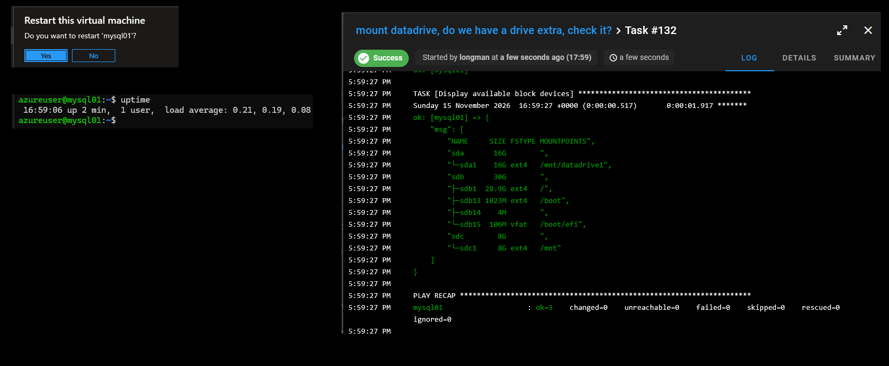


## 1.6 Run the mount_datadrive_for_mysql_azure.yml with boot step


Azure didn't break anything—it just demonstrated the exact reason why static device names like /dev/sdc cannot be trusted.

The Issue: Linux storage device paths (such as /dev/sda or /dev/sdc) are not guaranteed to remain consistent across restarts or when data disks are detached and reattached.

Safe Fstab Configuration: Use the nofail or nobootwait parameters in /etc/fstab so that the virtual machine can still boot successfully even if a data disk fails to mount.

However, because your Ansible playbook uses dynamic discovery and binds via UUID, it solves this problem entirely.

https://learn.microsoft.com/en-us/troubleshoot/azure/virtual-machines/linux/troubleshoot-device-names-problems


Here is the finalized, fully robust playbook that completely eliminates kernel letter variables for the storage operations.

```bash
# mount and run it
ansible-playbook -i inventory/hosts.ini playbooks/mount_datadrive_for_mysql_azure.yml
```

Log

```console

azureuser@ansiblectr01:~/ansible-io-ot-lab$ ansible-playbook -i inventory/hosts.ini playbooks/mount_datadrive_for_mysql_azure.yml

PLAY [Configure data disk storage at /data] *****************************************************************************************************************************************

TASK [Gathering Facts] **************************************************************************************************************************************************************
Sunday 15 November 2026  18:22:00 +0000 (0:00:00.011)       0:00:00.011 *******
ok: [mysql01]

TASK [Verify Azure LUN 0 symlink exists] ********************************************************************************************************************************************
Sunday 15 November 2026  18:22:02 +0000 (0:00:01.872)       0:00:01.884 *******
ok: [mysql01]

TASK [Fail if Azure LUN 0 data disk is missing] *************************************************************************************************************************************
Sunday 15 November 2026  18:22:03 +0000 (0:00:00.481)       0:00:02.365 *******
skipping: [mysql01]

TASK [Display resolved data disk LUN path] ******************************************************************************************************************************************
Sunday 15 November 2026  18:22:03 +0000 (0:00:00.018)       0:00:02.384 *******
ok: [mysql01] => {
    "msg": "Successfully anchored to persistent Azure LUN 0 path: /dev/disk/azure/scsi1/lun0"
}

TASK [Ensure partition 1 exists on data disk] ***************************************************************************************************************************************
Sunday 15 November 2026  18:22:03 +0000 (0:00:00.020)       0:00:02.404 *******
ok: [mysql01]

TASK [Format data partition to ext4 if not already formatted] ***********************************************************************************************************************
Sunday 15 November 2026  18:22:03 +0000 (0:00:00.537)       0:00:02.941 *******
ok: [mysql01]

TASK [Confirm before proceeding to Step 3 (UUID extraction and mounting)] ***********************************************************************************************************
Sunday 15 November 2026  18:22:04 +0000 (0:00:00.562)       0:00:03.504 *******
[Confirm before proceeding to Step 3 (UUID extraction and mounting)]
Ready to proceed with Step 3: UUID extraction and mounting at /data. Enter 'yes' to continue or anything else to abort.:
ok: [mysql01]

TASK [Abort playbook if user declined confirmation] *********************************************************************************************************************************
Sunday 15 November 2026  18:22:27 +0000 (0:00:23.790)       0:00:27.294 *******
skipping: [mysql01]

TASK [Get UUID of the data disk partition] ******************************************************************************************************************************************
Sunday 15 November 2026  18:22:27 +0000 (0:00:00.040)       0:00:27.334 *******
ok: [mysql01]

TASK [Set fact for disk UUID] *******************************************************************************************************************************************************
Sunday 15 November 2026  18:22:28 +0000 (0:00:00.526)       0:00:27.861 *******
ok: [mysql01]

TASK [Ensure /data mount point directory exists] ************************************************************************************************************************************
Sunday 15 November 2026  18:22:28 +0000 (0:00:00.042)       0:00:27.903 *******
ok: [mysql01]

TASK [Ensure persistent mount using UUID in fstab for /data] ************************************************************************************************************************
Sunday 15 November 2026  18:22:29 +0000 (0:00:00.481)       0:00:28.384 *******
changed: [mysql01]

TASK [Reboot target node to test fstab mount survival across boots] *****************************************************************************************************************
Sunday 15 November 2026  18:22:30 +0000 (0:00:01.324)       0:00:29.709 *******
changed: [mysql01]

TASK [Verify mount point is active after reboot] ************************************************************************************************************************************
Sunday 15 November 2026  18:22:53 +0000 (0:00:23.544)       0:00:53.253 *******
ok: [mysql01]

TASK [Display mount verification result] ********************************************************************************************************************************************
Sunday 15 November 2026  18:22:55 +0000 (0:00:01.384)       0:00:54.637 *******
ok: [mysql01] => {
    "msg": "Filesystem      Size  Used Avail Use% Mounted on\n/dev/sda1        16G  2.1M   15G   1% /data"
}

PLAY RECAP **************************************************************************************************************************************************************************
mysql01                    : ok=13   changed=2    unreachable=0    failed=0    skipped=2    rescued=0    ignored=0


TASKS RECAP *************************************************************************************************************************************************************************
Sunday 15 November 2026  18:22:55 +0000 (0:00:00.024)       0:00:54.662 *******
===============================================================================
Confirm before proceeding to Step 3 (UUID extraction and mounting) ---------------------------------------------------------------------------------------------------------- 23.79s
Reboot target node to test fstab mount survival across boots ---------------------------------------------------------------------------------------------------------------- 23.54s
Gathering Facts -------------------------------------------------------------------------------------------------------------------------------------------------------------- 1.87s
Verify mount point is active after reboot ------------------------------------------------------------------------------------------------------------------------------------ 1.38s
Ensure persistent mount using UUID in fstab for /data ------------------------------------------------------------------------------------------------------------------------ 1.32s
Format data partition to ext4 if not already formatted ----------------------------------------------------------------------------------------------------------------------- 0.56s
Ensure partition 1 exists on data disk --------------------------------------------------------------------------------------------------------------------------------------- 0.54s
Get UUID of the data disk partition ------------------------------------------------------------------------------------------------------------------------------------------ 0.53s
Verify Azure LUN 0 symlink exists -------------------------------------------------------------------------------------------------------------------------------------------- 0.48s
Ensure /data mount point directory exists ------------------------------------------------------------------------------------------------------------------------------------ 0.48s
Set fact for disk UUID ------------------------------------------------------------------------------------------------------------------------------------------------------- 0.04s
Abort playbook if user declined confirmation --------------------------------------------------------------------------------------------------------------------------------- 0.04s
Display mount verification result -------------------------------------------------------------------------------------------------------------------------------------------- 0.02s
Display resolved data disk LUN path ------------------------------------------------------------------------------------------------------------------------------------------ 0.02s
Fail if Azure LUN 0 data disk is missing ------------------------------------------------------------------------------------------------------------------------------------- 0.02s

PLAYBOOK RECAP **********************************************************************************************************************************************************************

```

Login to server:

```bash
azureuser@mysql01
uptime
 18:26:45 up 4 min,  1 user,  load average: 0.18, 0.36, 0.18

 lsblk
NAME    MAJ:MIN RM  SIZE RO TYPE MOUNTPOINTS
sda       8:0    0   16G  0 disk
└─sda1    8:1    0   16G  0 part /data
sdb       8:16   0   30G  0 disk
├─sdb1    8:17   0 28.9G  0 part /
├─sdb13   8:29   0 1023M  0 part /boot
├─sdb14   8:30   0    4M  0 part
└─sdb15   8:31   0  106M  0 part /boot/efi
sdc       8:32   0    8G  0 disk
└─sdc1    8:33   0    8G  0 part /mnt
```


Unmount it 

```bash
azureuser@mysql01:~$
azureuser@mysql01:~$ sudo umount /data
azureuser@mysql01:~$ mount | grep data
azureuser@mysql01:~$
```

Re run the playbook

```bash
azureuser@ansiblectr01:~/ansible-io-ot-lab$

ansible-playbook -i inventory/hosts.ini playbooks/mount_datadrive_for_mysql_azure.yml

```

Log

```consoleazureuser@ansiblectr01:~/ansible-io-ot-lab$ ansible-playbook -i inventory/hosts.ini playbooks/mount_datadrive_for_mysql_azure.yml

PLAY [Configure data disk storage at /data] *****************************************************************************************************************************************

TASK [Gathering Facts] **************************************************************************************************************************************************************
Sunday 15 November 2026  18:28:12 +0000 (0:00:00.011)       0:00:00.011 *******
ok: [mysql01]

TASK [Verify Azure LUN 0 symlink exists] ********************************************************************************************************************************************
Sunday 15 November 2026  18:28:14 +0000 (0:00:01.643)       0:00:01.655 *******
ok: [mysql01]

TASK [Fail if Azure LUN 0 data disk is missing] *************************************************************************************************************************************
Sunday 15 November 2026  18:28:15 +0000 (0:00:00.481)       0:00:02.136 *******
skipping: [mysql01]

TASK [Display resolved data disk LUN path] ******************************************************************************************************************************************
Sunday 15 November 2026  18:28:15 +0000 (0:00:00.018)       0:00:02.154 *******
ok: [mysql01] => {
    "msg": "Successfully anchored to persistent Azure LUN 0 path: /dev/disk/azure/scsi1/lun0"
}

TASK [Ensure partition 1 exists on data disk] ***************************************************************************************************************************************
Sunday 15 November 2026  18:28:15 +0000 (0:00:00.020)       0:00:02.175 *******
ok: [mysql01]

TASK [Format data partition to ext4 if not already formatted] ***********************************************************************************************************************
Sunday 15 November 2026  18:28:15 +0000 (0:00:00.535)       0:00:02.710 *******
ok: [mysql01]

TASK [Confirm before proceeding to Step 3 (UUID extraction and mounting)] ***********************************************************************************************************
Sunday 15 November 2026  18:28:16 +0000 (0:00:00.586)       0:00:03.297 *******
[Confirm before proceeding to Step 3 (UUID extraction and mounting)]
Ready to proceed with Step 3: UUID extraction and mounting at /data. Enter 'yes' to continue or anything else to abort.:
ok: [mysql01]

TASK [Abort playbook if user declined confirmation] *********************************************************************************************************************************
Sunday 15 November 2026  18:28:20 +0000 (0:00:04.437)       0:00:07.734 *******
skipping: [mysql01]

TASK [Get UUID of the data disk partition] ******************************************************************************************************************************************
Sunday 15 November 2026  18:28:20 +0000 (0:00:00.040)       0:00:07.775 *******
ok: [mysql01]

TASK [Set fact for disk UUID] *******************************************************************************************************************************************************
Sunday 15 November 2026  18:28:21 +0000 (0:00:00.514)       0:00:08.289 *******
ok: [mysql01]

TASK [Ensure /data mount point directory exists] ************************************************************************************************************************************
Sunday 15 November 2026  18:28:21 +0000 (0:00:00.043)       0:00:08.333 *******
ok: [mysql01]

TASK [Ensure persistent mount using UUID in fstab for /data] ************************************************************************************************************************
Sunday 15 November 2026  18:28:21 +0000 (0:00:00.480)       0:00:08.813 *******
changed: [mysql01]

TASK [Reboot target node to test fstab mount survival across boots] *****************************************************************************************************************
Sunday 15 November 2026  18:28:23 +0000 (0:00:01.315)       0:00:10.129 *******
changed: [mysql01]

TASK [Verify mount point is active after reboot] ************************************************************************************************************************************
Sunday 15 November 2026  18:28:46 +0000 (0:00:23.254)       0:00:33.383 *******
ok: [mysql01]

TASK [Display mount verification result] ********************************************************************************************************************************************
Sunday 15 November 2026  18:28:46 +0000 (0:00:00.477)       0:00:33.861 *******
ok: [mysql01] => {
    "msg": "Filesystem      Size  Used Avail Use% Mounted on\n/dev/sdc1        16G  2.1M   15G   1% /data"
}

PLAY RECAP **************************************************************************************************************************************************************************
mysql01                    : ok=13   changed=2    unreachable=0    failed=0    skipped=2    rescued=0    ignored=0


TASKS RECAP *************************************************************************************************************************************************************************
Sunday 15 November 2026  18:28:46 +0000 (0:00:00.022)       0:00:33.883 *******
===============================================================================
Reboot target node to test fstab mount survival across boots ---------------------------------------------------------------------------------------------------------------- 23.25s
Confirm before proceeding to Step 3 (UUID extraction and mounting) ----------------------------------------------------------------------------------------------------------- 4.44s
Gathering Facts -------------------------------------------------------------------------------------------------------------------------------------------------------------- 1.64s
Ensure persistent mount using UUID in fstab for /data ------------------------------------------------------------------------------------------------------------------------ 1.32s
Format data partition to ext4 if not already formatted ----------------------------------------------------------------------------------------------------------------------- 0.59s
Ensure partition 1 exists on data disk --------------------------------------------------------------------------------------------------------------------------------------- 0.54s
Get UUID of the data disk partition ------------------------------------------------------------------------------------------------------------------------------------------ 0.51s
Verify Azure LUN 0 symlink exists -------------------------------------------------------------------------------------------------------------------------------------------- 0.48s
Ensure /data mount point directory exists ------------------------------------------------------------------------------------------------------------------------------------ 0.48s
Verify mount point is active after reboot ------------------------------------------------------------------------------------------------------------------------------------ 0.48s
Set fact for disk UUID ------------------------------------------------------------------------------------------------------------------------------------------------------- 0.04s
Abort playbook if user declined confirmation --------------------------------------------------------------------------------------------------------------------------------- 0.04s
Display mount verification result -------------------------------------------------------------------------------------------------------------------------------------------- 0.02s
Display resolved data disk LUN path ------------------------------------------------------------------------------------------------------------------------------------------ 0.02s
Fail if Azure LUN 0 data disk is missing ------------------------------------------------------------------------------------------------------------------------------------- 0.02s

PLAYBOOK RECAP **********************************************************************************************************************************************************************

```

Rerun it again, now it will not boot


```bash

ansible-playbook -i inventory/hosts.ini playbooks/mount_datadrive_for_mysql_azure.yml

```

log

```console
azureuser@ansiblectr01:~/ansible-io-ot-lab$ ansible-playbook -i inventory/hosts.ini playbooks/mount_datadrive_for_mysql_azure.yml

PLAY [Configure data disk storage at /data] *****************************************************************************************************************************************

TASK [Gathering Facts] **************************************************************************************************************************************************************
Sunday 15 November 2026  18:30:04 +0000 (0:00:00.011)       0:00:00.011 *******
ok: [mysql01]

TASK [Verify Azure LUN 0 symlink exists] ********************************************************************************************************************************************
Sunday 15 November 2026  18:30:08 +0000 (0:00:03.978)       0:00:03.990 *******
ok: [mysql01]

TASK [Fail if Azure LUN 0 data disk is missing] *************************************************************************************************************************************
Sunday 15 November 2026  18:30:09 +0000 (0:00:00.477)       0:00:04.467 *******
skipping: [mysql01]

TASK [Display resolved data disk LUN path] ******************************************************************************************************************************************
Sunday 15 November 2026  18:30:09 +0000 (0:00:00.018)       0:00:04.486 *******
ok: [mysql01] => {
    "msg": "Successfully anchored to persistent Azure LUN 0 path: /dev/disk/azure/scsi1/lun0"
}

TASK [Ensure partition 1 exists on data disk] ***************************************************************************************************************************************
Sunday 15 November 2026  18:30:09 +0000 (0:00:00.022)       0:00:04.509 *******
ok: [mysql01]

TASK [Format data partition to ext4 if not already formatted] ***********************************************************************************************************************
Sunday 15 November 2026  18:30:09 +0000 (0:00:00.570)       0:00:05.079 *******
ok: [mysql01]

TASK [Confirm before proceeding to Step 3 (UUID extraction and mounting)] ***********************************************************************************************************
Sunday 15 November 2026  18:30:10 +0000 (0:00:00.517)       0:00:05.596 *******
[Confirm before proceeding to Step 3 (UUID extraction and mounting)]
Ready to proceed with Step 3: UUID extraction and mounting at /data. Enter 'yes' to continue or anything else to abort.:
ok: [mysql01]

TASK [Abort playbook if user declined confirmation] *********************************************************************************************************************************
Sunday 15 November 2026  18:30:12 +0000 (0:00:02.145)       0:00:07.742 *******
skipping: [mysql01]

TASK [Get UUID of the data disk partition] ******************************************************************************************************************************************
Sunday 15 November 2026  18:30:12 +0000 (0:00:00.040)       0:00:07.782 *******
ok: [mysql01]

TASK [Set fact for disk UUID] *******************************************************************************************************************************************************
Sunday 15 November 2026  18:30:12 +0000 (0:00:00.477)       0:00:08.259 *******
ok: [mysql01]

TASK [Ensure /data mount point directory exists] ************************************************************************************************************************************
Sunday 15 November 2026  18:30:12 +0000 (0:00:00.044)       0:00:08.304 *******
ok: [mysql01]

TASK [Ensure persistent mount using UUID in fstab for /data] ************************************************************************************************************************
Sunday 15 November 2026  18:30:13 +0000 (0:00:00.487)       0:00:08.792 *******
ok: [mysql01]

TASK [Reboot target node to test fstab mount survival across boots] *****************************************************************************************************************
Sunday 15 November 2026  18:30:13 +0000 (0:00:00.478)       0:00:09.270 *******
skipping: [mysql01]

TASK [Verify mount point is active after reboot] ************************************************************************************************************************************
Sunday 15 November 2026  18:30:13 +0000 (0:00:00.043)       0:00:09.313 *******
ok: [mysql01]

TASK [Display mount verification result] ********************************************************************************************************************************************
Sunday 15 November 2026  18:30:14 +0000 (0:00:00.378)       0:00:09.692 *******
ok: [mysql01] => {
    "msg": "Filesystem      Size  Used Avail Use% Mounted on\n/dev/sdc1        16G  2.1M   15G   1% /data"
}

PLAY RECAP **************************************************************************************************************************************************************************
mysql01                    : ok=12   changed=0    unreachable=0    failed=0    skipped=3    rescued=0    ignored=0


TASKS RECAP *************************************************************************************************************************************************************************
Sunday 15 November 2026  18:30:14 +0000 (0:00:00.022)       0:00:09.715 *******
===============================================================================
Gathering Facts -------------------------------------------------------------------------------------------------------------------------------------------------------------- 3.98s
Confirm before proceeding to Step 3 (UUID extraction and mounting) ----------------------------------------------------------------------------------------------------------- 2.15s
Ensure partition 1 exists on data disk --------------------------------------------------------------------------------------------------------------------------------------- 0.57s
Format data partition to ext4 if not already formatted ----------------------------------------------------------------------------------------------------------------------- 0.52s
Ensure /data mount point directory exists ------------------------------------------------------------------------------------------------------------------------------------ 0.49s
Ensure persistent mount using UUID in fstab for /data ------------------------------------------------------------------------------------------------------------------------ 0.48s
Verify Azure LUN 0 symlink exists -------------------------------------------------------------------------------------------------------------------------------------------- 0.48s
Get UUID of the data disk partition ------------------------------------------------------------------------------------------------------------------------------------------ 0.48s
Verify mount point is active after reboot ------------------------------------------------------------------------------------------------------------------------------------ 0.38s
Set fact for disk UUID ------------------------------------------------------------------------------------------------------------------------------------------------------- 0.04s
Reboot target node to test fstab mount survival across boots ----------------------------------------------------------------------------------------------------------------- 0.04s
Abort playbook if user declined confirmation --------------------------------------------------------------------------------------------------------------------------------- 0.04s
Display resolved data disk LUN path ------------------------------------------------------------------------------------------------------------------------------------------ 0.02s
Display mount verification result -------------------------------------------------------------------------------------------------------------------------------------------- 0.02s
Fail if Azure LUN 0 data disk is missing ------------------------------------------------------------------------------------------------------------------------------------- 0.02s

PLAYBOOK RECAP **********************************************************************************************************************************************************************

```

### The output from blkid and findmnt confirms that your storage configuration is working exactly as designed to handle Azure's device letter shuffling.

```bash

azureuser@mysql01

# Check all block IDs and UUIDs:
sudo blkid
/dev/sdb1: UUID="3860a288-2e11-421e-8c98-21af4c26b23e" BLOCK_SIZE="4096" TYPE="ext4" PARTUUID="4ad8c561-01"
/dev/sdc1: UUID="0cb1edea-689d-4f8d-a669-50771ea9c493" BLOCK_SIZE="4096" TYPE="ext4" PARTUUID="57e46430-01"
/dev/sda15: LABEL_FATBOOT="UEFI" LABEL="UEFI" UUID="5353-05B6" BLOCK_SIZE="512" TYPE="vfat" PARTUUID="8e3b5471-519b-4639-aed0-b1ed4db4a849"
/dev/sda1: LABEL="cloudimg-rootfs" UUID="e35d8284-eb05-4a00-98b3-487a131894eb" BLOCK_SIZE="4096" TYPE="ext4" PARTLABEL="cloudimg-rootfs" PARTUUID="98952342-930d-4591-9893-b9eb526e5ae6"
/dev/sda13: LABEL="BOOT" UUID="3312e900-936e-4190-941c-35a3a1610664" BLOCK_SIZE="4096" TYPE="ext4" PARTUUID="a5047308-8902-4370-a1cc-f91de25f279c"
/dev/sda14: PARTUUID="fbe7b93c-189f-4ed3-88ae-940112b729fe"

# Check active mounts:
findmnt /data
TARGET SOURCE    FSTYPE OPTIONS
/data  /dev/sdc1 ext4   rw,noatime

```

What Just Happened

1. Device Letter Shuffling: During the reboot, Azure's SCSI subsystem re-enumerated the device letters, moving your data disk from /dev/sda (on the previous boot) to /dev/sdc (on this boot).

2. UUID Resilience in Action: Because your playbook configured /etc/fstab using the partition's permanent filesystem UUID rather than a static device path, the Linux kernel ignored the letter change, successfully found the correct partition (/dev/sdc1), and mounted it at /data with the full 16 GiB capacity.


```bash
azureuser@mysql01

# Verification: Should output /data backed by ext4 with rw,noatime options.
findmnt /data

# Verification: Should report the full 16G capacity with ~15G available.
df -h /data/
```

Version 3.8.0 is the correct and fully robust playbook for configuring Azure data disks.


No, the Azure LUN path (/dev/disk/azure/...) will not work on VMware (ESXi/vSphere) or KVM.

Yes, maintaining two separate playbooks—or structuring a single playbook with conditional platform tasks—is the cleanest and most robust approach when managing infrastructure across multiple hypervisors like Azure and KVM/VMware.


# Set up github integration on ansiblectr01 for git pull origin main

Do Git clone git@github.com:spawnmarvel/ansible-io-ot-lab, so we can do git git pull orgin main from ansiblectr01

It is better to push new playbooks to github and get them on ansiblectr01, then we always have the latest version for this demo.

```bash
azureuser@ansiblectr01:~$ cd ~/.ssh/

# get the id
cat id_rsa.pub

```

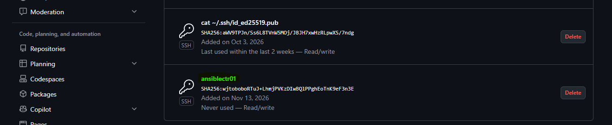


Clone it and get all files


```bash

azureuser@ansiblectr01:~$ git clone git@github.com:spawnmarvel/ansible-io-ot-lab.git
Cloning into 'ansible-io-ot-lab'...
remote: Enumerating objects: 107, done.
remote: Counting objects: 100% (107/107), done.
remote: Compressing objects: 100% (91/91), done.
remote: Total 107 (delta 29), reused 89 (delta 14), pack-reused 0 (from 0)
Receiving objects: 100% (107/107), 5.52 MiB | 6.75 MiB/s, done.
Resolving deltas: 100% (29/29), done.

```

Now you can do change in VSC local and push to github and pull to ansiblectr01


```bash
azureuser@ansiblectr01:~$ cd ansible-io-ot-lab/
azureuser@ansiblectr01:~/ansible-io-ot-lab$ git pull origin main
From github.com:spawnmarvel/ansible-io-ot-lab
 * branch            main       -> FETCH_HEAD
Already up to date.

azureuser@ansiblectr01:~/ansible-io-ot-lab$ ls
ansible.cfg  images  inventory  playbooks  quickguides  readme.md

```

# Update Semaphore to use ansible-io-ot-lab and not io_io_lab folder

Settings in Ui

* Repository was /home/azureuser/io_ot_lab 
* * /home/azureuser/ansible-io-ot-lab

* Inventory was inventory/hosts.ini 
* * Keep

* Task Templates was playbooks/configure_apt_proxy.yml
* Keep


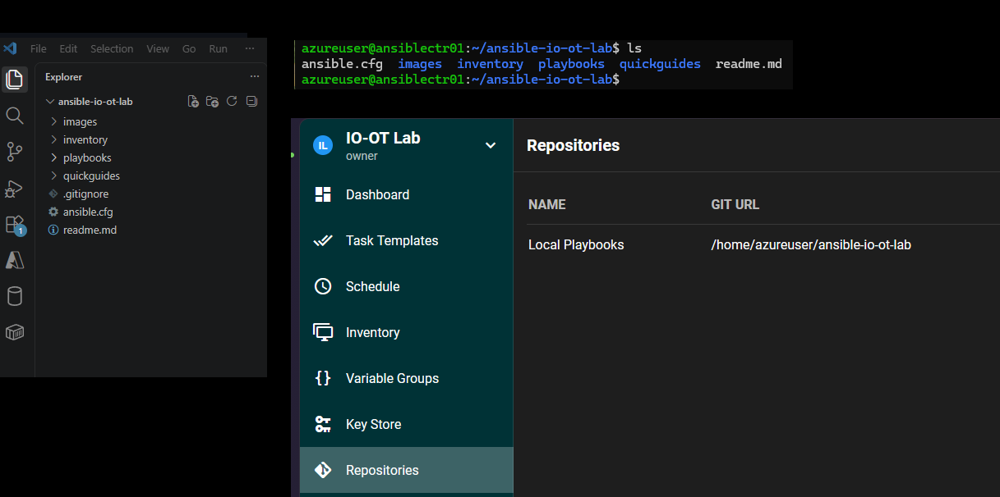


# Pause and inspect all playbooks with comments

At this point we have done many things, lest.

1. Comment all our playbooks
2. Understand all functions we have used

We update the quickguides/ansible_quickguide for this

# Introduction to Enterprise Ansible Scalability

Ok, we have done a lot, let's sti back for some moments and recap and go into the right direction.

Up to this point, our proof-of-concept has relied on flat, linear playbooks containing tasks and inline variables. 

While this is efficient for bootstrapping and basic operations (like updating packages or mounting a secondary disk), scaling up to install MySQL 8.4 LTS, Zabbix Server, Zabbix Proxies, and configuring Windows VMs requires a more structured, production-grade approach.

Before diving into the full software stack deployment, adopting core enterprise Ansible patterns—specifically Roles, Templates, Handlers, and Vault—will keep your code clean, modular, and maintainable.

## 1. Ansible Roles (Modular Structure)

Instead of cramming every task for MySQL or Zabbix into a single massive playbook, Ansible Roles allow you to break your automation down into logical, reusable directory structures.


```txt
roles/
└── mysql/
    ├── tasks/
    │   └── main.yml
    ├── handlers/
    │   └── main.yml
    ├── templates/
    │   └── my.cnf.j2
    ├── vars/
    │   └── main.yml
    └── defaults/
        └── main.yml
```
Why use it? It allows the database team, network team, and monitoring team to write and maintain their own isolated roles without stepping on each other's code, which can then be called cleanly from a master playbook:


```yml
- hosts: db_servers
  roles:
    - mysql
```


## 2. Jinja2 Templates (.j2)

When installing complex software like MySQL or Zabbix, configuration files (my.cnf, zabbix_server.conf, zabbix_proxy.conf) cannot be static static text files. They need to dynamically adapt based on host IPs, memory limits, or inventory variables.

Ansible uses the Jinja2 templating engine. Instead of using the copy module with static text, you use the template module:


```yml
- name: Deploy Zabbix Server configuration file
  ansible.builtin.template:
    src: zabbix_server.conf.j2
    dest: /etc/zabbix/zabbix_server.conf
    owner: root
    group: zabbix
    mode: '0640'
  notify: Restart Zabbix Server

```

## 3. Handlers (Event-Driven Service Restarts)

Configuration changes should only trigger service restarts if a file or setting actually changes. Running systemctl restart mysql on every single playbook run is bad practice.

## 4. Ansible Vault (Secure Secret Management)

As you deploy MySQL databases and Zabbix integrations, your playbooks and inventory will require sensitive data such as database root passwords, API tokens, and Windows administrator credentials.

## 5. Custom Facts and Block/Rescue Error Handling

Block / Rescue / Always: For complex deployments (like setting up a database schema or handling Windows reboots), you can wrap tasks in programming-style try/catch blocks to gracefully handle errors or execute cleanup steps if a task fails.

Custom Facts: You can gather environment-specific variables dynamically during the execution phase to make playbooks self-tuning based on available memory or CPU cores.

# Let's start Enterprise Ansible Scalability

## Playbook install_mysql.yml with Roles --check or limit or hosts:groups

### 1 Role Directory Structure
Create the following directory layout inside your repository root (roles/mysql/):

A standard role organizes tasks, variables, defaults, templates, files, and handlers into a dedicated subfolder:

```bash

azureuser@ansiblectr01:

cd ansible-io-ot-lab/

ls

ansible-io-ot-lab\playbooks\roles\mysql

Mode                 LastWriteTime         Length Name
----                 -------------         ------ ----
d----          13.11.2026    21:55                defaults
d----          13.11.2026    21:55                handlers
d----          13.11.2026    21:55                tasks
d----          13.11.2026    21:55                templates
d----          13.11.2026    21:55                vars

```

1. Role Configuration and Tasks
   
* roles/mysql/defaults/main.yml
  
2. Defines default variables for the root password and binding address.

* roles/mysql/handlers/main.yml
  
3. Handles event-driven service restarts when configuration files are modified.

* roles/mysql/templates/override.cnf.j2
  
4. Configures custom binding and paths for the server.

* roles/mysql/tasks/main.yml
  
Performs the package installation, secures the installation, applies custom config, and ensures the service is running.


```bash
azureuser@ansiblectr01:~/ansible-io-ot-lab

# pull files
 git pull origin main
remote: Enumerating objects: 18, done.
remote: Counting objects: 100% (18/18), done.
remote: Compressing objects: 100% (7/7), done.
# [...]

# list files and folders
azureuser@ansiblectr01:~/ansible-io-ot-lab/playbooks$ ls
configure_apt_proxy.yml  mount_datadrive.yml        roles
deploy_mysql.yml         mount_datadrive_check.yml  update_apt.yml
get_linux_version.yml    ping_hosts.yml             verify_firewall_isolation.yml
```

The directory structure is fully populated and correctly aligned with the roles/ directory containing your MySQL setup.

### playbooks/deploy_mysql_check.yml

Let's run our playbook for check candidate on ubunt 26.04, mysql is shipped default!

```bash
ansible-playbook -i inventory/hosts.ini playbooks/deploy_mysql_check.yml
```

log
```console
[...]

TASK [Check if mysql-server package is available in apt cache] *******************************
Friday 13 November 2026  21:13:52 +0000 (0:00:10.090)       0:00:12.179 *******
ok: [mysql01]

TASK [Display available MySQL package versions] **********************************************
Friday 13 November 2026  21:13:52 +0000 (0:00:00.559)       0:00:12.738 *******
ok: [mysql01] => {
    "msg": [
        "mysql-server:",
        "  Installed: (none)",
        "  Candidate: 8.4.13-0ubuntu0.26.04.2",
        "  Version table:",
        "     8.4.13-0ubuntu0.26.04.2 500",
        "        500 http://azure.archive.ubuntu.com/ubuntu resolute-updates/main amd64v3 Packages",
        "        500 http://azure.archive.ubuntu.com/ubuntu resolute-security/main amd64v3 Packages",
        "     8.4.8-0ubuntu1 500",
        "        500 http://azure.archive.ubuntu.com/ubuntu resolute/main amd64v3 Packages"
    ]
}
```

* Package Availability: MySQL 8.4 LTS (8.4.13-0ubuntu0.26.04.2) is fully available via the apt repository cache.

* Service State: Confirmed as not yet installed.

* Storage Mount: The secondary data volume (/dev/sda1) is perfectly partitioned, formatted, and mounted at /var/lib/mysql with 30GB of available space ready for database operations.


To allow remote hosts (such as zabbix01 at 10.68.68.5) to connect to your MySQL server (mysql01), two things are required:

1. Network Binding: The MySQL daemon must listen on network interfaces rather than just loopback. We already handled this in our override template (roles/mysql/templates/override.cnf.j2) by setting bind-address = 0.0.0.0.

2. User Privileges: MySQL user accounts must be granted access from remote hosts (either a specific IP like 10.68.68.5, a subnet like 10.68.68.%, or globally via %).

### playbooks/deploy_mysql.yml --limit mysql01


Run in check mode
```bash
ansible-playbook -i inventory/hosts.ini playbooks/deploy_mysql.yml --limit mysql01


```

log

```console
PLAY RECAP **********************************************************************************
mysql01                    : ok=8    changed=0    unreachable=0    failed=0    skipped=12   rescued=0    ignored=0


TASKS RECAP *********************************************************************************
Sunday 15 November 2026  21:18:28 +0000 (0:00:00.039)       0:00:09.558 *******
===============================================================================
Gathering Facts ---------------------------------------------------------------------- 1.87s
mysql : Install MySQL server package ------------------------------------------------- 1.03s
mysql : Stop MySQL service during data directory initialization check ---------------- 0.79s
mysql : Apply custom MySQL configuration override ------------------------------------ 0.71s
mysql : Ensure persistent MySQL data directory exists with correct permissions before init --- 0.51s
mysql : Initialize MySQL data directory on persistent storage if uninitialized ------- 0.50s
mysql : Update AppArmor profile to allow access to custom datadir -------------------- 0.50s
mysql : Check if MySQL system database is initialized on persistent storage ---------- 0.50s
mysql : Ensure correct ownership and permissions on persistent MySQL data directory --- 0.38s
mysql : Check if test database exists ------------------------------------------------ 0.38s
mysql : Check if root password is already configured --------------------------------- 0.38s
mysql : Create remote-accessible Zabbix database user and database ------------------- 0.38s
mysql : Check if anonymous MySQL users exist ----------------------------------------- 0.37s
mysql : Create root user for 127.0.0.1 and ::1 --------------------------------------- 0.37s
mysql : Check if Zabbix database user exists ----------------------------------------- 0.37s
mysql : Check if root@127.0.0.1 user exists and is configured ------------------------ 0.37s
mysql : Remove test database --------------------------------------------------------- 0.04s
mysql : Remove anonymous MySQL users ------------------------------------------------- 0.04s
mysql : Ensure AppArmor service is reloaded if profile changed ----------------------- 0.02s
mysql : Set root password for MySQL root user on localhost --------------------------- 0.02s

PLAYBOOK RECAP ******************************************************************************
```

Now deploy it

```bash

ansible-playbook -i inventory/hosts.ini playbooks/deploy_mysql.yml
```
log

```console
TASKS RECAP ********************************************************************************************************
Sunday 15 November 2026  22:00:58 +0000 (0:00:00.043)       0:00:10.572 *******
===============================================================================
Gathering Facts --------------------------------------------------------------------------------------------- 1.85s
mysql : Install MySQL server package ------------------------------------------------------------------------ 1.46s
mysql : Reload AppArmor service to apply new rules ---------------------------------------------------------- 0.96s
mysql : Apply custom MySQL configuration override pointing to datadir --------------------------------------- 0.71s
mysql : Ensure MySQL service is started and enabled --------------------------------------------------------- 0.56s
mysql : Ensure correct ownership and permissions on persistent MySQL data directory ------------------------- 0.49s
mysql : Check if root password is already configured -------------------------------------------------------- 0.49s
mysql : Check if default MySQL system database exists in package path --------------------------------------- 0.48s
mysql : Create root user for 127.0.0.1 and ::1 -------------------------------------------------------------- 0.48s
mysql : Update AppArmor profile to allow access to custom datadir ------------------------------------------- 0.47s
mysql : Create remote-accessible Zabbix database user and database ------------------------------------------ 0.42s
mysql : Check if test database exists ----------------------------------------------------------------------- 0.40s
mysql : Check if anonymous MySQL users exist ---------------------------------------------------------------- 0.39s
mysql : Check if Zabbix database user exists ---------------------------------------------------------------- 0.39s
mysql : Check if root@127.0.0.1 user exists and is configured ----------------------------------------------- 0.39s
mysql : Check if MySQL system database is already initialized on persistent storage ------------------------- 0.39s
mysql : Remove test database -------------------------------------------------------------------------------- 0.04s
mysql : Remove anonymous MySQL users ------------------------------------------------------------------------ 0.04s
mysql : Ensure MySQL service is restarted if configuration changed ------------------------------------------ 0.02s
mysql : Set root password for MySQL root user on localhost -------------------------------------------------- 0.02s

PLAYBOOK RECAP *****************************************************************************************************
Playbook run took 0 days, 0 hours, 0 minutes, 10 seconds

```

Then we are done with installing myql, we introduced a lot of new key words.

You can read about them in the playbook comments.


#### Verify mysql as root and zabbix via ssh on localhost

We have not installed anything on zabbix01 yet, mysql client will come with zabbix, so lest check it.

```bash
# Since we created a root user with access only on localhost, w emust test it

ssh azureuser@10.68.68.6

sudo mysql
# Welcome to the MySQL monitor.  Commands end with ; or \g


```

sql

```sql
select user, host from mysql.user;
+------------------+-----------+
| user             | host      |
+------------------+-----------+
| zabbix           | %         |
| root             | 127.0.0.1 |
| root             | ::1       |
| debian-sys-maint | localhost |
| mysql.infoschema | localhost |
| mysql.session    | localhost |
| mysql.sys        | localhost |
| root             | localhost |
+------------------+-----------+


mysql -u zabbix -p'it-is-a-secret-not-this' -e "SELECT VERSION();"
mysql: [Warning] Using a password on the command line interface can be insecure.
+-------------------------+
| VERSION()               |
+-------------------------+
| 8.4.13-0ubuntu0.26.04.2 |
+-------------------------+

```


### playbooks/login_mysql_check.yml --limit mysql01 with var zabbix_password

Let's try to login and verfiy our zabbix user.

But we need to change step two steps.

1. Change defaults/main.yml

```yml
---
# Version: 1.0.0
# Description: Default variables for MySQL role deployment.

mysql_root_password: "it-is-a-secret-not-this-na"
# add this so we can reference it in new playbooks
zabbix_password: "it-is-a-secret-not-this"
mysql_bind_address: "0.0.0.0"
mysql_port: 3306
```

2. Update task/main.yml to use that reference zabbix_password

```yml

# [...]

- name: Create remote-accessible Zabbix database user and database
  ansible.builtin.command: >
    mysql -u root -p'{{ mysql_root_password }}' -e "CREATE USER IF NOT EXISTS 'zabbix'@'%' IDENTIFIED BY '{{ zabbix_password }}'; CREATE DATABASE IF NOT EXISTS zabbix CHARACTER SET utf8mb4 COLLATE utf8mb4_bin; GRANT ALL PRIVILEGES ON zabbix.* TO 'zabbix'@'%'; FLUSH PRIVILEGES;"
  when: zabbix_user_check.rc != 0 or zabbix_user_check.stdout == ""
  changed_when: true

# [...]
```
Now all playbooks can use that password and it works.

```bash
# Test deploy and check that is works, it does.
ansible-playbook -i inventory/hosts.ini playbooks/deploy_mysql.yml --limit mysql01 --check

# Run deploy

ansible-playbook -i inventory/hosts.ini playbooks/deploy_mysql.yml --limit mysql01

# Now back to verify user

ansible-playbook -i inventory/hosts.ini playbooks/login_mysql_user_zabbix.yml --limit mysql01
```


And the result is again success, view below.

login_mysql_user_zabbix.yml

```yml
---
# Version: 1.4.0
# Description: Login to MySQL as the Zabbix user to verify that the user has been created and can access the database.
# aspen
- name: Login to MySQL as Zabbix user
  hosts: db_servers
  become: true
  # here we are using vars_files to include the default variables from the mysql role, which contains the zabbix_password variable
  vars_files:
    - roles/mysql/defaults/main.yml
  tasks:
    - name: Print the Zabbix user password for debugging purposes
      ansible.builtin.debug:
        msg: "Zabbix user password is: {{ zabbix_password }}"
    - name: Try logging in to MySQL as the Zabbix user to verify access
      ansible.builtin.command: mysql -h 10.68.68.6 -u zabbix -p'{{ zabbix_password }}' -e "SELECT CURRENT_USER();"
      register: mysql_version_output
      failed_when: false
      changed_when: false

    - name: Print the output of the MySQL login attempt
      ansible.builtin.debug:
        msg: "MySQL login output: {{ mysql_version_output.stdout }}"

```

Here we learned to:

1. Reference roles/mysql/defaults/main.yml with the password
2. Use ansible.builtin.debug and print it
3. Capture SQL output and print it with same method


   
Result:

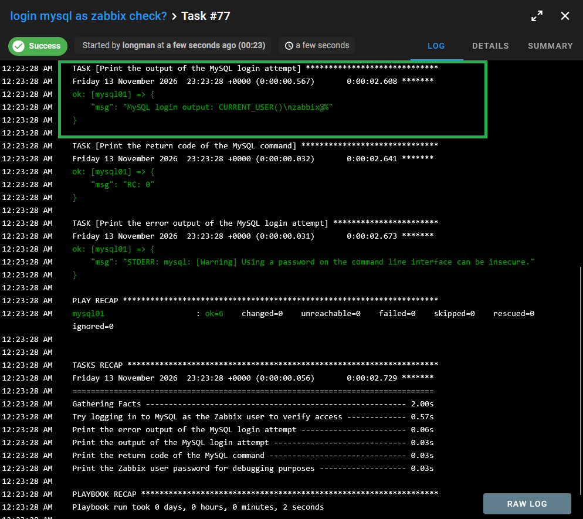


## playbooks/deploy_mysql.yml --limit mysql01 Ansible Vault

What we did is bad, password in file....

To eliminate plain-text passwords from your repository, the industry-standard approach in Ansible is Ansible Vault. Vault allows you to encrypt sensitive variable files (like your role defaults or dedicated secret files) while keeping them fully transparent to Ansible during execution.

### 1. Encrypt Your Variables File

If you want to encrypt your existing role defaults file (roles/mysql/defaults/main.yml), run the following command on your control node:

```bash

azureuser@ansiblectr01:~/ansible-io-ot-lab

# If you are currently in your project root (~/ansible-io-ot-lab), you do not need to cd into the playbooks directory. 
# Running the command from the root ensures Ansible finds the correct path to your role's defaults file.

ansible-vault encrypt roles/mysql/defaults/main.yml

New Vault password:
Confirm New Vault password:
Encryption successful
```


(Note: Ensure .vault_pass.txt is added to your .gitignore so it never gets committed to source control).

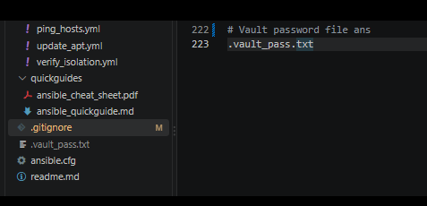


#### Option A: Interactive Prompt (Best for Manual Runs)

Add the --ask-vault-pass flag when running your playbooks:

```bash
ansible-playbook -i inventory/hosts.ini playbooks/deploy_mysql.yml --ask-vault-pass
```

#### Option B: Vault Password File (Best for Automation / CI/CD)

For automated pipelines or local convenience without repeated password prompts, you can store the vault password in a local file (e.g., .vault_pass.txt) and reference it:

1. Save your vault password to a local file:


```bash
echo "YourSuperSecretVaultPassword" > .vault_pass.txt
chmod 600 .vault_pass.txt
```

2. Add it to your ansible.cfg file under [defaults] so Ansible picks it up automatically:

```ini
[defaults]
vault_password_file = .vault_pass.txt
```

3. Run your playbooks normally without needing any extra flags:

```bash
ansible-playbook -i inventory/hosts.ini playbooks/deploy_mysql.yml
```

Log

```console
PLAY [Deploy Secure MySQL Database Server] *************************************************************************

TASK [Gathering Facts] *********************************************************************************************
Sunday 15 November 2026  22:09:44 +0000 (0:00:00.014)       0:00:00.014 *******
ok: [mysql01]

TASK [mysql : Install MySQL server package] ************************************************************************
Sunday 15 November 2026  22:09:46 +0000 (0:00:02.709)       0:00:02.724 *******
ok: [mysql01]

TASK [mysql : Check if default MySQL system database exists in package path] ***************************************
Sunday 15 November 2026  22:09:48 +0000 (0:00:01.533)       0:00:04.258 *******
ok: [mysql01]

TASK [mysql : Check if MySQL system database is already initialized on persistent storage] *************************
Sunday 15 November 2026  22:09:48 +0000 (0:00:00.481)       0:00:04.740 *******
ok: [mysql01]

TASK [mysql : Stop MySQL service before migrating data directory] **************************************************
Sunday 15 November 2026  22:09:49 +0000 (0:00:00.386)       0:00:05.126 *******
skipping: [mysql01]

TASK [mysql : Ensure parent /data directory exists with correct permissions] ***************************************
Sunday 15 November 2026  22:09:49 +0000 (0:00:00.021)       0:00:05.147 *******
skipping: [mysql01]

TASK [mysql : Ensure persistent MySQL target directory is absent before migration] *********************************
Sunday 15 November 2026  22:09:49 +0000 (0:00:00.019)       0:00:05.167 *******
skipping: [mysql01]

TASK [mysql : Create persistent MySQL target directory] ************************************************************
Sunday 15 November 2026  22:09:49 +0000 (0:00:00.019)       0:00:05.187 *******
skipping: [mysql01]

TASK [mysql : Migrate default MySQL data directory to persistent storage using rsync] ******************************
Sunday 15 November 2026  22:09:49 +0000 (0:00:00.020)       0:00:05.207 *******
skipping: [mysql01]

TASK [mysql : Update AppArmor profile to allow access to custom datadir] *******************************************
Sunday 15 November 2026  22:09:49 +0000 (0:00:00.019)       0:00:05.227 *******
ok: [mysql01]

TASK [mysql : Reload AppArmor service to apply new rules] **********************************************************
Sunday 15 November 2026  22:09:49 +0000 (0:00:00.469)       0:00:05.696 *******
changed: [mysql01]

TASK [mysql : Ensure correct ownership and permissions on persistent MySQL data directory] *************************
Sunday 15 November 2026  22:09:50 +0000 (0:00:00.968)       0:00:06.664 *******
ok: [mysql01]

TASK [mysql : Apply custom MySQL configuration override pointing to datadir] ***************************************
Sunday 15 November 2026  22:09:51 +0000 (0:00:00.489)       0:00:07.154 *******
ok: [mysql01]

TASK [mysql : Ensure MySQL service is restarted if configuration changed] ******************************************
Sunday 15 November 2026  22:09:51 +0000 (0:00:00.715)       0:00:07.869 *******
skipping: [mysql01]

TASK [mysql : Ensure MySQL service is started and enabled] *********************************************************
Sunday 15 November 2026  22:09:51 +0000 (0:00:00.024)       0:00:07.893 *******
ok: [mysql01]

TASK [mysql : Check if root password is already configured] ********************************************************
Sunday 15 November 2026  22:09:52 +0000 (0:00:00.563)       0:00:08.457 *******
ok: [mysql01]

TASK [mysql : Set root password for MySQL root user on localhost] **************************************************
Sunday 15 November 2026  22:09:52 +0000 (0:00:00.485)       0:00:08.943 *******
skipping: [mysql01]

TASK [mysql : Check if root@127.0.0.1 user exists and is configured] ***********************************************
Sunday 15 November 2026  22:09:53 +0000 (0:00:00.020)       0:00:08.963 *******
ok: [mysql01]

TASK [mysql : Create root user for 127.0.0.1 and ::1] **************************************************************
Sunday 15 November 2026  22:09:53 +0000 (0:00:00.390)       0:00:09.353 *******
skipping: [mysql01]

TASK [mysql : Check if Zabbix database user exists] ****************************************************************
Sunday 15 November 2026  22:09:53 +0000 (0:00:00.021)       0:00:09.375 *******
ok: [mysql01]

TASK [mysql : Create remote-accessible Zabbix database user and database] ******************************************
Sunday 15 November 2026  22:09:53 +0000 (0:00:00.387)       0:00:09.762 *******
changed: [mysql01]

TASK [mysql : Check if anonymous MySQL users exist] ****************************************************************
Sunday 15 November 2026  22:09:54 +0000 (0:00:00.413)       0:00:10.175 *******
ok: [mysql01]

TASK [mysql : Remove anonymous MySQL users] ************************************************************************
Sunday 15 November 2026  22:09:54 +0000 (0:00:00.390)       0:00:10.565 *******
skipping: [mysql01]

TASK [mysql : Check if test database exists] ***********************************************************************
Sunday 15 November 2026  22:09:54 +0000 (0:00:00.041)       0:00:10.607 *******
ok: [mysql01]

TASK [mysql : Remove test database] ********************************************************************************
Sunday 15 November 2026  22:09:55 +0000 (0:00:00.392)       0:00:11.000 *******
skipping: [mysql01]

PLAY RECAP *********************************************************************************************************
mysql01                    : ok=15   changed=2    unreachable=0    failed=0    skipped=10   rescued=0    ignored=0  


TASKS RECAP ********************************************************************************************************
Sunday 15 November 2026  22:09:55 +0000 (0:00:00.043)       0:00:11.044 *******
===============================================================================
Gathering Facts --------------------------------------------------------------------------------------------- 2.71s
mysql : Install MySQL server package ------------------------------------------------------------------------ 1.53s
mysql : Reload AppArmor service to apply new rules ---------------------------------------------------------- 0.97s
mysql : Apply custom MySQL configuration override pointing to datadir --------------------------------------- 0.72s
mysql : Ensure MySQL service is started and enabled --------------------------------------------------------- 0.56s
mysql : Ensure correct ownership and permissions on persistent MySQL data directory ------------------------- 0.49s
mysql : Check if root password is already configured -------------------------------------------------------- 0.49s
mysql : Check if default MySQL system database exists in package path --------------------------------------- 0.48s
mysql : Update AppArmor profile to allow access to custom datadir ------------------------------------------- 0.47s
mysql : Create remote-accessible Zabbix database user and database ------------------------------------------ 0.41s
mysql : Check if test database exists ----------------------------------------------------------------------- 0.39s
mysql : Check if anonymous MySQL users exist ---------------------------------------------------------------- 0.39s
mysql : Check if root@127.0.0.1 user exists and is configured ----------------------------------------------- 0.39s
mysql : Check if Zabbix database user exists ---------------------------------------------------------------- 0.39s
mysql : Check if MySQL system database is already initialized on persistent storage ------------------------- 0.39s
mysql : Remove test database -------------------------------------------------------------------------------- 0.04s
mysql : Remove anonymous MySQL users ------------------------------------------------------------------------ 0.04s
mysql : Ensure MySQL service is restarted if configuration changed ------------------------------------------ 0.02s
mysql : Create root user for 127.0.0.1 and ::1 -------------------------------------------------------------- 0.02s
mysql : Stop MySQL service before migrating data directory -------------------------------------------------- 0.02s

PLAYBOOK RECAP *****************************************************************************************************
```

#### Configure Semaphore with a Vault Password

To use Ansible Vault with Ansible Semaphore (the web UI automation platform), you do not type the password manually every time. Instead, you configure Semaphore with a Vault Password associated with your project or environment so it can automatically decrypt your encrypted files (roles/mysql/defaults/main.yml) when running playbooks.

1. Step 1: Create a Vault Password Store in Semaphore
  
In the Ansible Semaphore UI, "Login with password" is the correct key type to use for storing an Ansible Vault password.

2. Step 2: Attach the Vault Key to your playbooks
3. Add the vault key and build your playbook

# Reboot mysql01 and verify all playbooks before install zabbix

1. playbooks/ping_hosts.yml
2. playbooks/get_linux_version.yml
3. playbooks/update_apt.yml
4. playbooks/mount_datadrive_check.yml
5. playbooks/mount_datadrive_for_mysql_azure.yml
6. playbooks/deploy_mysql_check.yml
7. playbooks/deploy_mysql.yml
8. playbooks/login_mysql_user_zabbix.yml

## deploy_mysql.yml information on multiple deploy bg1


# Playbook deploy_zabbix.yml --check or limit or hosts:groups


With mysql01 fully deployed, hardened, and pre-seeded with the Zabbix database and remote user privileges, your database backend is completely ready for the Zabbix server and proxy nodes.

```bash

azureuser@ansiblectr01:

cd ansible-io-ot-lab/

cd playbooks/roles/zabbix/
ls
defaults  handlers  tasks  templates

# if the play is ok, remove --check with --diff and or --limit

ansible-playbook -i inventory/hosts.ini playbooks/deploy_zabbix.yml

```


# Windows new project ansible-io-ot-lab-windows

For windows navigate to that folder:

ansible-io-ot-lab-windows

1. Create the same folder structure
2. inventory, hosts.ini
3. ansible.cfg
4. playbooks

That way we separated IT OT Linux and Windows into two projects with each own configurations.


